# TA - TA-WRITER: JSON-driven technical analysis tool

> Repos analysed: `tools/worklog` (branch `feat/poker-analyses-sections` @ `eba196b`, used only as the reference pattern; `tools/ta-writer` is empty and not versioned yet) · Skills read: `technical-analysis-writer`, `technical-analysis-agir-writer` · Date: 2026-11-22

## Context
Technical analyses (TA) are written as Markdown by the `technical-analysis-writer` skill and published to Jira and Confluence by Python scripts that parse that Markdown (`technical-analysis-agir-writer`). There is no standard intermediate format. `ta-writer` is a local Symfony + PHP + Docker tool whose source of truth is a **JSON document** (structure given as an OpenAPI 3.1 file) stored in the project, built through a schema-driven UI or injected through a complete REST API, then published in several formats through extensible adapters (raw JSON, Markdown, PDF, Confluence API, Confluence AGIR). The tool contains no AI and does not analyse code.

## Implementation decisions taken while building (2026-11-23)
- **Symfony 8.1 (latest stable), PHP 8.4**: Symfony 8.1 requires PHP 8.4.1; the image is `php:8.4-cli`. The earlier 6.3 and 6.4 choices were superseded on request ("dernière version de symfony").
- **No Flex**: the composer container cannot reach GitHub, so the Symfony components are declared by hand; the kernel, console and front controller are written without recipes.
- **PHP syntax**: `final readonly class` is not used; classes are `final` with `public readonly` properties, so the code also runs on older 8.x patch levels.
- **UI without AssetMapper or Stimulus**: the form is generated on the server from the OpenAPI schema (`SchemaFormBuilder` -> `FieldNode` tree -> recursive Twig templates) and a small vanilla script handles the repeatable lists. Same behaviour, no Node build step.
- **One rendering model** (`DocumentModelBuilder`) for the Markdown, the PDF and the Confluence pages: titles carry the reference, calculated sections (criteria coverage, SQL impact, dependencies) are computed once.
- **Dev serving**: `php -S` in the PHP container on `127.0.0.1:8080`; noVNC on `127.0.0.1:6080` for the AGIR login. No nginx, no MongoDB.
- **Document ids** are `<YYYYMMDD>_<slug>`; the slug comes from the project reference alone, collisions get `-2`, `-3`.
- **AGIR epic and technical-story pages** start from the reference pages of the AGIR skill (`3398621794`, `3399544715`), whose details cells are replaced by label. Reading the CFDITS templates directly (storage body) is not implemented: the reference pages are the proven source; the template ids are kept as documentation.
- **Writes are batched**: Confluence and AGIR runs write their links back into the JSON in one new version at the end, even when the run stopped halfway; pages already written keep their link.

## Scope
- In scope:
  - JSON storage in the project (`data/analyses`), with a full version history, restore, and diff.
  - REST API (documents, JSON Patch, versions, schema) and a UI whose form is generated from the OpenAPI YAML, so a new property appears without code.
  - Schema validation and business validation (unique references, dependency cycles, acceptance-criteria coverage).
  - Publication core (Symfony command + UI page, per-adapter options) and five adapters: raw JSON, Markdown, PDF (mPDF), Confluence API (page tree), Confluence AGIR (Chrome driven by PHP, Jira tickets, page create/update).
  - Reference prefix `<project> <epic> <ts> <subtask> - <title>` before every title, 1 to n epics everywhere, links written back into the JSON (`ticket`, `pageLink`).
  - A **dependencies page** in every export that has pages (Markdown, PDF, Confluence API, AGIR), each end linking to its `pageLink`.
- Out of scope:
  - Code analysis, AI generation, importing the Markdown produced by the skills.
  - Authentication/authorization of the tool itself (local single-user tool).
  - Kubernetes or any non-development database (the tool uses none).
  - Scope and Impact-analysis sections of the skill's TA format (not carried by the JSON, so they are omitted from exports; see Open points).

## Impact analysis
- `config/schema/document.openapi.yaml` (new) — single source of truth: validation, form generation and `/api/schema` all derive from it; the user-provided file is extended with `Epic.what`, `Document.dependenciesPageLink`, `Subtask.featureToggle` and `Subtask.sqlImpact { nbColumns, nbRows }` and its `paths` are renamed to `/api/documents`. Risk: a wrong schema change breaks every consumer; covered by TS2 tests.
- `TaRepositoryInterface::save()` (new) — the only write path; API, UI and adapters (write-back of `ticket` / `pageLink`) all go through it, so history cannot be bypassed. Risk: concurrent writers (UI tab + running export); handled by the expected-version check (409).
- Confluence (AGIR instance `espace.agir.orange.com`, space `CFDITS`) — the AGIR adapter creates and **updates** pages (unlike the skill, which adopted existing pages untouched). Decision: an update rewrites the **whole** page body from the Confluence page template (epic `1942192145`, technical story `655556613`, subtask `3304849414`) and overwrites earlier edits, human edits included; Confluence's own page history is the only way back.
- Jira (`portail.agir.orange.com`, projects `CFPOPR` / `CFPOBT`) — tickets are created by the AGIR adapter; a replayed POST could duplicate issues, so a created `ticket` is written to the JSON before anything else and a failed POST is never replayed.
- Secrets — Jira/Confluence PATs live in `.env.local` (gitignored; `JIRA_PAT`, `CONFLUENCE_PAT`, optionally the Symfony secrets vault), the AGIR login lives in the gitignored Chrome profile `data/chrome-profile/`; no secret is ever written to the JSON, its history, an export or a log.
- PHP image — gains Node, `@mermaid-js/mermaid-cli`, Google Chrome, Xvfb and noVNC (TS12, TS15); the image becomes heavy but stays local.
- No existing code is modified: the repository is new. `worklog` is read-only reference (Makefile, `docker/`, `.php-cs-fixer.dist.php`, `phpstan.dist.neon` at level 6, `phpunit.xml.dist`).

## Feature toggle
No feature toggle — new internal tooling with no existing behaviour to protect, so there is no toggle-removal subtask either.

## Acceptance criteria coverage
*All acceptance criteria below are derived from the request — to confirm.*

| AC | Covered by |
|---|---|
| AC1 — An analysis is stored as a JSON file inside the `ta-writer` project (`data/analyses/<YYYYMMDD>/<slug>.json`), written atomically | • TS1 Subtask4 - Configure the storage and export directories<br>• TS3 Subtask4 - Create JsonFileTaRepository with the read methods<br>• TS3 Subtask5 - Add save() and delete() |
| AC2 — A complete REST API creates, reads, replaces, patches (TS, subtasks, reordering) and deletes documents, and exposes the schema | • TS5 Subtask2 - Create DocumentController with the read endpoints<br>• TS5 Subtask3 - Add the create, replace and delete endpoints<br>• TS5 Subtask4 - Add the JSON Patch endpoint<br>• TS5 Subtask5 - Create SchemaController |
| AC3 — Every write is versioned; versions are listed, diffed and restorable from the API and the UI | • TS4 Subtask3 - Snapshot on every save and reject stale writes<br>• TS4 Subtask5 - Add restore()<br>• TS5 Subtask6 - Create VersionController<br>• TS9 Subtask3 - Create the versions panel and the diff view |
| AC4 — The UI form is generated from the OpenAPI YAML; a new property shows up without code | • TS2 Subtask1 - Add the OpenAPI schema file<br>• TS8 Subtask1..5 (form builder, Twig, Stimulus)<br>• TS9 Subtask1 - Create EditorController<br>• TS9 Subtask2 - Save from the editor through the API |
| AC5 — Publication from a Symfony command and from the UI, format chosen by the user, per-adapter questions, extensible adapters | • TS10 Subtask1 - Create the publication contracts<br>• TS10 Subtask2 - Create PublisherRegistry<br>• TS10 Subtask3 - Create PublicationService<br>• TS10 Subtask4 - Create PublishCommand<br>• TS10 Subtask5 - Create PublishController and the publish page |
| AC6 — Raw JSON export, and the JSON Schema is published | • TS11 Subtask1 - Create JsonPublisher<br>• TS5 Subtask5 - Create SchemaController |
| AC7 — Markdown and PDF share the same layout; the PDF has a cover, a clickable table of contents, header/footer, dependency and AC sections, and a page break before every epic and every technical story | • TS7 Subtask4 - Create DocumentModelBuilder<br>• TS7 Subtask5 - Add the calculated sections<br>• TS11 Subtask2 - Create MarkdownPublisher<br>• TS12 Subtask2 - Create MermaidRenderer<br>• TS13 Subtask1..3 (PdfPublisher, cover/TOC/header-footer, page breaks) |
| AC8 — Confluence API publishes a page tree (TA > TS > Subtask), fully rewrites pages that already exist, and saves each page link in the JSON; an instance that rejects a PAT makes the adapter fail with an explicit "not usable" exception | • TS14 Subtask1 - Create ConfluenceClientInterface and HttpConfluenceClient<br>• TS14 Subtask2 - Create ConfluencePagePublisher<br>• TS14 Subtask3 - Create StorageFormatBuilder<br>• TS14 Subtask4 - Create ConfluenceApiPublisher |
| AC9 — AGIR: Chrome driven entirely by PHP, user authenticates when needed, publication resumes, pages are created/updated, Jira epics/technical stories/subtasks are created and their keys and links written back into the JSON | • TS15 Subtask1..4 (browser session)<br>• TS16 Subtask1..3 (Jira)<br>• TS17 Subtask1..4 (AGIR publisher) |
| AC10 — Every title is preceded by the top-to-bottom reference (`<project> <epic> <ts> <subtask> - <title>`) in documents, Confluence pages and the UI | • TS7 Subtask1 - Create ReferenceResolver<br>• TS9 Subtask1 - Create EditorController<br>• TS11 Subtask2 - Create MarkdownPublisher<br>• TS14 Subtask4 - Create ConfluenceApiPublisher<br>• TS17 Subtask4 - Create AgirPublisher |
| AC11 — One or several epics work everywhere without special case | • TS7 Subtask4 - Create DocumentModelBuilder<br>• TS17 Subtask4 - Create AgirPublisher |
| AC12 — Documents are validated (schema + business rules) before save and before any export | • TS2 Subtask4 - Create SchemaValidationException and SchemaValidator<br>• TS6 Subtask1..5 (business rules)<br>• TS10 Subtask3 - Create PublicationService |
| AC13 — Every export contains a dependencies page (section/page) whose entries link to the `pageLink` found in the JSON | • TS7 Subtask5 - Add the calculated sections<br>• TS11 Subtask2 - Create MarkdownPublisher<br>• TS13 Subtask3 - Add the page breaks and the calculated sections<br>• TS14 Subtask5 - Add the dependencies page to ConfluenceApiPublisher<br>• TS17 Subtask5 - Add the dependencies page to AgirPublisher<br>• Note: the raw JSON export already carries `dependencies[]` and every `pageLink` |

## TS dependencies

| TS | Blocks |
|---|---|
| TS1 - Project bootstrap and Docker stack | TS2, TS3, TS7, TS12 |
| TS2 - OpenAPI schema loading and validation | TS5, TS8 |
| TS3 - JSON file storage | TS4, TS16 |
| TS4 - Version history | TS5 |
| TS5 - REST API | TS6, TS9 |
| TS6 - Business validation | TS10 |
| TS7 - References and document render model | TS9, TS10 |
| TS8 - Schema-driven form builder | TS9 |
| TS9 - Editor, list and versions UI | — |
| TS10 - Publication core | TS11, TS13, TS14 |
| TS11 - JSON and Markdown adapters | — |
| TS12 - Mermaid rendering | TS13, TS14, TS15 |
| TS13 - PDF adapter | — |
| TS14 - Confluence page publisher and Confluence API adapter | TS17 |
| TS15 - Browser session for AGIR | TS17 |
| TS16 - Jira ticket creation | TS17 |
| TS17 - AGIR publisher | — |

TS8, TS7, TS3/TS4 can be developed in parallel once TS1 and TS2 are merged; TS11 and TS13 are independent of each other; TS15 and TS16 are independent of each other.

## Technical stories

| TS | Subtask | Columns | Rows |
|---|---|---|---|
| — | — | — | — |

No subtask changes SQL: the tool has no database, so the SQL-impact tables are empty and every per-TS table shows `—`. Only migrations would be counted.

New classes created by this TA (namespaces: `App\Schema`, `App\Storage`, `App\Storage\History`, `App\Api`, `App\Validation`, `App\Reference`, `App\Render`, `App\Ui`, `App\Publication`, `App\Publication\Adapter`, `App\Browser`, `App\Jira`).

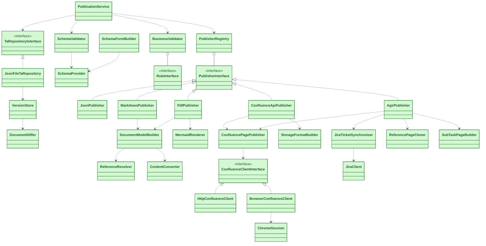

### TA-WRITER TS1 - Project bootstrap and Docker stack

| Subtask | Columns | Rows |
|---|---|---|
| TS1 Subtask1 - Create the Symfony skeleton and initialise git | — | — |
| TS1 Subtask2 - Add the Docker stack and the Makefile | — | — |
| TS1 Subtask3 - Add the code-quality tooling | — | — |
| TS1 Subtask4 - Configure the storage and export directories | — | — |

#### TA-WRITER TS1 Subtask1 : Create the Symfony skeleton and initialise git

##### What
Create the Symfony 6.3 skeleton in `tools/ta-writer` with the same dependency set as `worklog` that this tool needs, and initialise the git repository on `master`.

##### Why
`tools/ta-writer` is empty and `tools/` is not a repository, so nothing can be built, versioned or installed until the skeleton and its `composer.json` exist.

##### Where
- `ta-writer/composer.json`, `composer.lock`, `symfony.lock` (new) — pattern: `worklog/composer.json`.
- `ta-writer/src/Kernel.php`, `bin/console`, `public/index.php`, `config/` (new) — standard `symfony/skeleton` recipe, same as `worklog/src/Kernel.php`.
- `ta-writer/.gitignore` (new).

##### How
- [ ] Run `composer create-project symfony/skeleton:"6.3.*" .` through the composer container of TS1 Subtask2 (until then, a temporary `docker run composer`).
- [ ] Require the runtime packages: `symfony/framework-bundle`, `symfony/twig-bundle`, `symfony/asset-mapper`, `symfony/stimulus-bundle`, `symfony/yaml`, `symfony/http-client`, `symfony/process`, `symfony/serializer`, `symfony/string`, `symfony/cache`, `opis/json-schema`, `league/commonmark`, `league/html-to-markdown`, `mpdf/mpdf`, `chrome-php/chrome`, `symfony/html-sanitizer`.
- [ ] Require the dev packages used by `worklog`: `phpunit/phpunit:^9.5`, `phpstan/phpstan`, `friendsofphp/php-cs-fixer`, `symfony/maker-bundle`.
- [ ] Set `"php": ">=8.1"` and the `App\` / `App\Tests\` PSR-4 mapping exactly as in `worklog/composer.json`.
- [ ] Add `.gitignore` entries: `/vendor/`, `/var/`, `/data/`, `.env.local`, `.idea/`.
- [ ] Run `git init -b master` and commit on `master` (no branch for now).

> ⚠️ Re-check the exact package names/versions at install time (`chrome-php/chrome`, `league/html-to-markdown`); any package that does not install on PHP 8.1 is replaced in the subtask that uses it.

After deployment: `bin/console about` prints Symfony 6.3 (AC4 and every later AC depend on this skeleton).

#### TA-WRITER TS1 Subtask2 : Add the Docker stack and the Makefile

##### What
Add the nginx / php / composer containers and a Makefile with the same targets as `worklog`, so the whole tool runs in Docker.

##### Why
The host PHP CLI only exposes `json` and `sockets`, so Composer, PHPUnit and the console must run in a container with the extensions the tool needs (`mbstring`, `curl`, `zip`, `gd`, `intl`).

##### Where
- `ta-writer/docker-compose.yml` (new) — pattern: `worklog/docker-compose.yml` (services `nginx`, `php`, `composer`, volume `.:/app`).
- `ta-writer/docker/php/Dockerfile`, `docker/php/php.ini`, `docker/nginx/nginx.conf`, `docker/composer/Dockerfile` (new) — pattern: the same files in `worklog/docker/`.
- `ta-writer/Makefile` (new) — pattern: `worklog/Makefile` (`help`, `composer-install`, `composer-require`, `composer`, `fix-cs`, `console`, `sh`, `start`).

##### How
- [ ] Copy the three `worklog/docker/*` folders and adapt: PHP 8.1-fpm image with `pdo` not needed, plus `gd`, `intl`, `zip`, `mbstring`, `bcmath`.
- [ ] Drop the `mongo` and `node` services of `worklog` (no database; Node is added to the php image in TS12).
- [ ] Use `nginx:1.25-alpine` instead of `1.11-alpine` and expose the app on a fixed local port (`8080`).
- [ ] Copy the Makefile targets, keeping `USERID`/`GROUPID` so files are not owned by root.
- [ ] Add `make console c="…"`, `make test`, `make stan`.

After deployment: `make start` serves the welcome route on `http://localhost:8080` and `make console c=about` works.

#### TA-WRITER TS1 Subtask3 : Add the code-quality tooling

##### What
Add php-cs-fixer, PHPStan and PHPUnit configuration so every following subtask is checked the same way.

##### Why
Without a PHPUnit config that lists `tests/`, tests never run; without PHPStan the readonly value objects and generic arrays of this tool would silently drift.

##### Where
- `ta-writer/.php-cs-fixer.dist.php` (new) — pattern: `worklog/.php-cs-fixer.dist.php`.
- `ta-writer/phpstan.dist.neon` (new) — pattern: `worklog/phpstan.dist.neon` (level 6); start at level 6.
- `ta-writer/phpunit.xml.dist` (new) — pattern: `worklog/phpunit.xml.dist`; suite `unit` = `tests/`.

##### How
- [ ] Copy the three config files and adapt the paths (`src`, `tests`).
- [ ] Add `make fix-cs`, `make stan`, `make test` targets (reuse the `worklog` `fix-cs` recipe).
- [ ] Add a smoke test `tests/KernelTest.php` that boots the kernel, proving the `tests/` folder is collected by `phpunit.xml.dist`.

After deployment: `make test`, `make stan`, `make fix-cs` all pass on the skeleton.

#### TA-WRITER TS1 Subtask4 : Configure the storage and export directories

##### What
Declare where documents and exports live (inside the project) and make the paths configurable.

##### Why
The decision is that analyses live in `ta-writer/data/analyses`, not in `technical_analyses`; without a single configured root every class would hard-code its own path.

##### Where
- `ta-writer/.env` (new keys `TA_STORAGE_DIR`, `TA_EXPORT_DIR`, `TA_HISTORY_MAX`) and `.env.local` (not committed, holds the secrets `JIRA_PAT`, `CONFLUENCE_PAT`).
- `ta-writer/config/services.yaml` (new parameters `app.storage_dir`, `app.export_dir`, `app.history_max`) — pattern: `worklog/config/services.yaml`.
- `ta-writer/data/.gitkeep` is **not** created; `data/` is gitignored (TS1 Subtask1).

##### How
- [ ] Add `TA_STORAGE_DIR=%kernel.project_dir%/data/analyses`, `TA_EXPORT_DIR=%kernel.project_dir%/data/exports`, `TA_HISTORY_MAX=0` (0 = unlimited) in `.env`.
- [ ] Map them to the parameters above in `services.yaml`, so services receive `string $storageDir` through `bind`.
- [ ] Declare the secrets as empty placeholders in `.env` (`JIRA_PAT=`, `CONFLUENCE_PAT=`) with the real values only in `.env.local`; add `bin/console secrets:set` as the optional vault alternative.
- [ ] Rule for every later subtask: a secret is read from the environment or asked with hidden input, and never written to the JSON, the history, an export or a log.
- [ ] Unit tests for the parameter resolution (kernel test reading the container parameters).

After deployment: `bin/console debug:container --parameters` lists the three parameters (AC1).

### TA-WRITER TS2 - OpenAPI schema loading and validation

| Subtask | Columns | Rows |
|---|---|---|
| TS2 Subtask1 - Add the OpenAPI schema file | — | — |
| TS2 Subtask2 - Create SchemaProvider | — | — |
| TS2 Subtask3 - Add getDocumentJsonSchema() | — | — |
| TS2 Subtask4 - Create SchemaValidationException and SchemaValidator | — | — |

#### TA-WRITER TS2 Subtask1 : Add the OpenAPI schema file

##### What
Copy the user-provided OpenAPI 3.1 file into the project as the single source of truth and add the three decided fields.

##### Why
The UI form, the validation and `/api/schema` must all derive from one file; the three fields (`what` on the epic, `featureToggle` and `sqlImpact` on the subtask) are missing from the provided structure.

##### Where
- `ta-writer/config/schema/document.openapi.yaml` (new).

##### How
- [ ] Paste the provided YAML unchanged, then change `paths` to `/api/documents` and `/api/documents/{id}`.
- [ ] Add `what: string` to `components.schemas.Epic.properties`.
- [ ] Add `featureToggle: string` and `sqlImpact: { type: object, required: [nbColumns, nbRows], properties: { nbColumns: integer, nbRows: integer } }` to `Subtask.properties`.
- [ ] Add `dependenciesPageLink: { type: string, format: uri }` to `Document.properties` (link of the dependencies page, written by the Confluence adapters so the next export updates the same page).
- [ ] Keep `Document.required: [format, project, author, epics]` and `Epic.required` as provided (the `technicalStories` inconsistency is in Open points).

```yaml
# config/schema/document.openapi.yaml — Document addition
dependenciesPageLink:
  type: string
  format: uri
  description: Page listing the dependencies, written back by the Confluence adapters.
# config/schema/document.openapi.yaml — Subtask additions
featureToggle:
  type: string
  description: Feature toggle guarding this subtask.
sqlImpact:
  type: object
  required: [nbColumns, nbRows]
  properties:
    nbColumns: { type: integer, minimum: 0 }
    nbRows:    { type: integer, minimum: 0 }
```

After deployment: `yq '.components.schemas.Subtask.properties | keys' config/schema/document.openapi.yaml` lists both new keys (AC4).

#### TA-WRITER TS2 Subtask2 : Create SchemaProvider

##### What
Create `SchemaProvider` with its constructor and the YAML loading; `TS2 Subtask3` adds the JSON Schema extraction.

##### Why
Every schema consumer needs one cached, parsed copy of the YAML whose cache is invalidated when the file changes, otherwise each request reparses it.

##### Where
- `ta-writer/src/Schema/SchemaProvider.php` (new, `App\Schema`).
- `ta-writer/config/services.yaml` (bind `string $schemaPath`).

##### How
- [ ] Create `final class SchemaProvider` with `__construct(private string $schemaPath, private CacheInterface $cache)`.
- [ ] Add `getOpenApi(): array` loading the file with `Symfony\Component\Yaml\Yaml::parseFile()` and caching it under a key that contains `filemtime($schemaPath)`.
- [ ] Throw `\RuntimeException` when the file is missing.
- [ ] Unit tests for `SchemaProvider` (load, cache reuse, cache miss after mtime change, missing file).

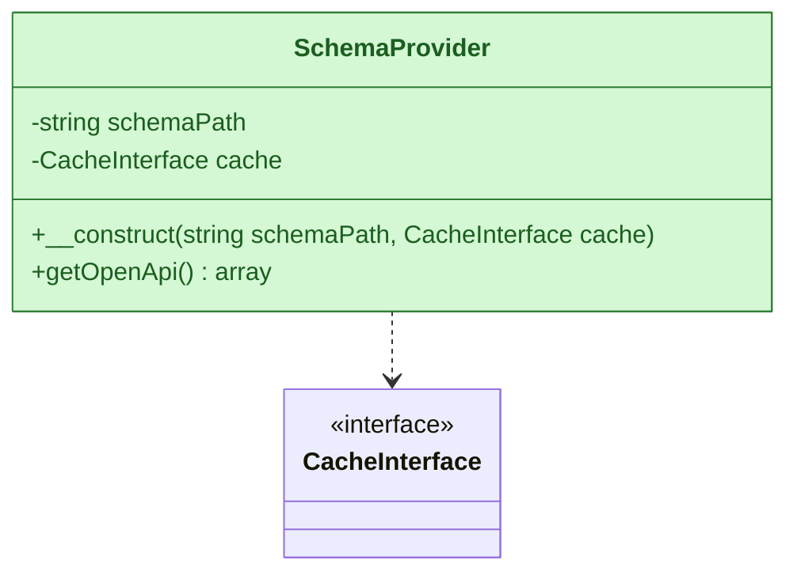

`SchemaProvider` is a standalone class, no parent and no interface.

| Method | IN | Output | Description |
|---|---|---|---|
| `__construct()` | `string $schemaPath, CacheInterface $cache` | — | Stores the schema path and the cache. |
| `getOpenApi()` | — | `array` | Parsed OpenAPI document, cached per file modification time. |

#### TA-WRITER TS2 Subtask3 : Add getDocumentJsonSchema()

##### What
Add `SchemaProvider::getDocumentJsonSchema()` returning the `Document` schema as a self-contained JSON Schema with every `$ref` resolved.

##### Why
`opis/json-schema` and the form builder both need a resolved `Document` tree; OpenAPI 3.1 is JSON Schema 2020-12 compatible, so only the `#/components/schemas/...` references need inlining.

##### Where
- `ta-writer/src/Schema/SchemaProvider.php` (changed).

##### How
- [ ] Add `getDocumentJsonSchema(): object` that starts at `components.schemas.Document` and replaces each `$ref` `#/components/schemas/<Name>` by the referenced schema, recursively.
- [ ] Guard against reference cycles (keep a stack of names, throw `\LogicException` on a cycle).
- [ ] Keep `examples`, `description`, `enum`, `format`, `required` untouched (the UI reads them in TS8).
- [ ] Unit tests for `SchemaProvider::getDocumentJsonSchema()` (nested `$ref`, array `items` `$ref`, cycle guard).

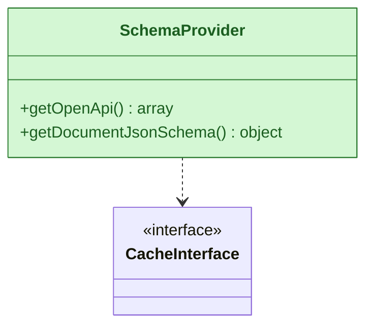

`SchemaProvider` is a standalone class, no parent and no interface; `getDocumentJsonSchema()` is (new).

| Method | IN | Output | Description |
|---|---|---|---|
| `getDocumentJsonSchema()` | — | `object` | `Document` schema with all component `$ref` inlined. |

#### TA-WRITER TS2 Subtask4 : Create SchemaValidationException and SchemaValidator

##### What
Create the exception and the validator that checks a decoded document against the `Document` schema.

##### Why
The API, the UI save and every export must refuse a document that breaks the structure (AC12); a typed exception lets the API answer 422 with the list of errors.

##### Where
- `ta-writer/src/Schema/SchemaValidationException.php` (new).
- `ta-writer/src/Schema/SchemaValidator.php` (new).

##### How
- [ ] Create `SchemaValidationException extends \RuntimeException` with `__construct(array $errors)` and `getErrors(): array` (list of `{path, message}`).
- [ ] Create `final class SchemaValidator` with `__construct(SchemaProvider $provider)` and `validate(array $document): void`.
- [ ] Use `Opis\JsonSchema\Validator` with the schema from `getDocumentJsonSchema()`; convert `ValidationError` objects to `{path, message}` using `ErrorFormatter`.
- [ ] Unit tests for `SchemaValidator` (valid document, missing `format`, wrong enum, nested `sqlImpact` type error).

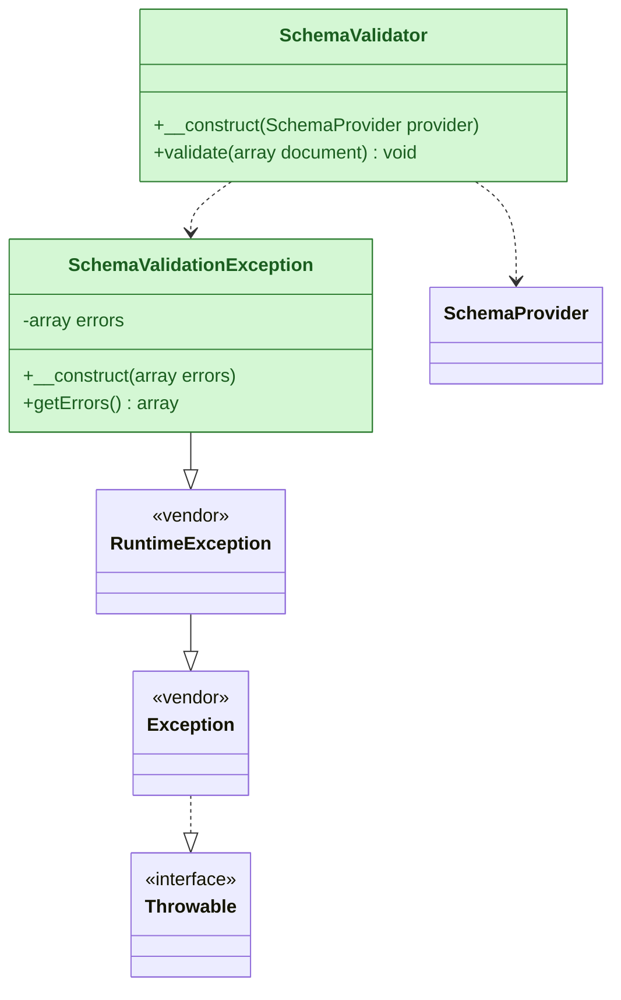

`SchemaValidationException extends \RuntimeException` (`RuntimeException extends Exception implements Throwable`); `SchemaValidator` is standalone, no parent and no interface.

| Method | IN | Output | Description |
|---|---|---|---|
| `validate()` | `array $document` | `void` | Throws `SchemaValidationException` listing every schema error. |
| `getErrors()` | — | `array` | Errors as `{path, message}` pairs. |

### TA-WRITER TS3 - JSON file storage

| Subtask | Columns | Rows |
|---|---|---|
| TS3 Subtask1 - Create the repository contracts | — | — |
| TS3 Subtask2 - Create AtomicFileWriter | — | — |
| TS3 Subtask3 - Create SlugGenerator | — | — |
| TS3 Subtask4 - Create JsonFileTaRepository with the read methods | — | — |
| TS3 Subtask5 - Add save() and delete() | — | — |

#### TA-WRITER TS3 Subtask1 : Create the repository contracts

##### What
Create `TaRepositoryInterface`, the `StoredDocument` value object and `DocumentNotFoundException`.

##### Why
API, UI and adapters must depend on one contract so every write goes through `save()` (and therefore through history).

##### Where
- `ta-writer/src/Storage/TaRepositoryInterface.php`, `StoredDocument.php` (new).
- `ta-writer/src/Storage/Exception/DocumentNotFoundException.php` (new).

##### How
- [ ] Create `StoredDocument` (final readonly): `string $id`, `array $data`, `int $version`, `\DateTimeImmutable $updatedAt`.
- [ ] Create `TaRepositoryInterface` with `list(): array`, `get(string $id): StoredDocument`, `save(string $id, array $data, string $origin, ?int $expectedVersion = null): StoredDocument`, `delete(string $id): void`, `restore(string $id, int $version, string $origin): StoredDocument`.
- [ ] Create `DocumentNotFoundException extends \RuntimeException` with `forId(string $id): self`.
- [ ] Id format: `<YYYYMMDD>_<slug>` (maps to `data/analyses/<YYYYMMDD>/<slug>.json`).

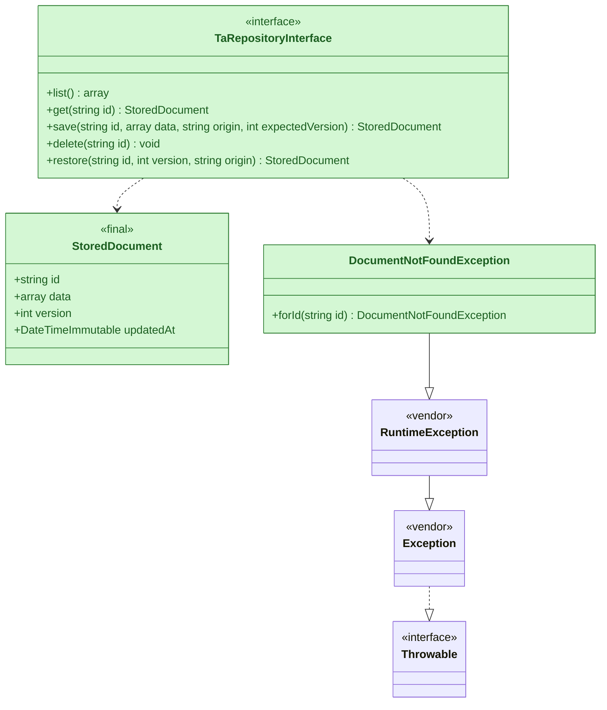

`StoredDocument` is a standalone final class; `DocumentNotFoundException extends \RuntimeException` (`RuntimeException extends Exception implements Throwable`); `TaRepositoryInterface` has no parent (implemented by `JsonFileTaRepository`, TS3 Subtask4).

#### TA-WRITER TS3 Subtask2 : Create AtomicFileWriter

##### What
Create a small service that writes a file atomically (temporary file in the same directory, then `rename`).

##### Why
A crash or a second writer during `file_put_contents` would leave a truncated JSON; the document and every version file must never be half-written.

##### Where
- `ta-writer/src/Storage/AtomicFileWriter.php` (new).

##### How
- [ ] Create `final class AtomicFileWriter` with `write(string $path, string $contents): void`.
- [ ] Create the directory when missing (`mkdir -p` equivalent, mode `0775`), write to `<path>.tmp.<pid>`, `rename()` over the target, remove the temp file on failure and throw `\RuntimeException`.
- [ ] Unit tests for `AtomicFileWriter` (new file, overwrite, missing directory, unwritable directory).

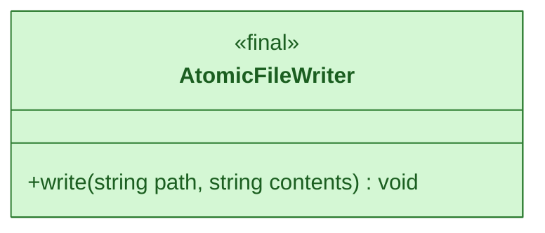

`AtomicFileWriter` is a standalone class, no parent or interface.

| Method | IN | Output | Description |
|---|---|---|---|
| `write()` | `string $path, string $contents` | `void` | Atomic write: temp file then rename. |

#### TA-WRITER TS3 Subtask3 : Create SlugGenerator

##### What
Create the service that builds a document slug from the project reference and name.

##### Why
File names must be stable, ASCII and unique per day; the slug is the document's identity in URLs and CLI arguments.

##### Where
- `ta-writer/src/Storage/SlugGenerator.php` (new).

##### How
- [ ] Create `final class SlugGenerator` with `__construct(AsciiSlugger $slugger = new AsciiSlugger())`.
- [ ] Add `generate(string $reference, string $name): string` returning `lower(slug("<reference> <name>"))`, falling back to `document` when both are empty.
- [ ] Uniqueness (suffix `-2`, `-3`) is handled by `JsonFileTaRepository`, not here.
- [ ] Unit tests for `SlugGenerator` (accents, spaces, empty input).

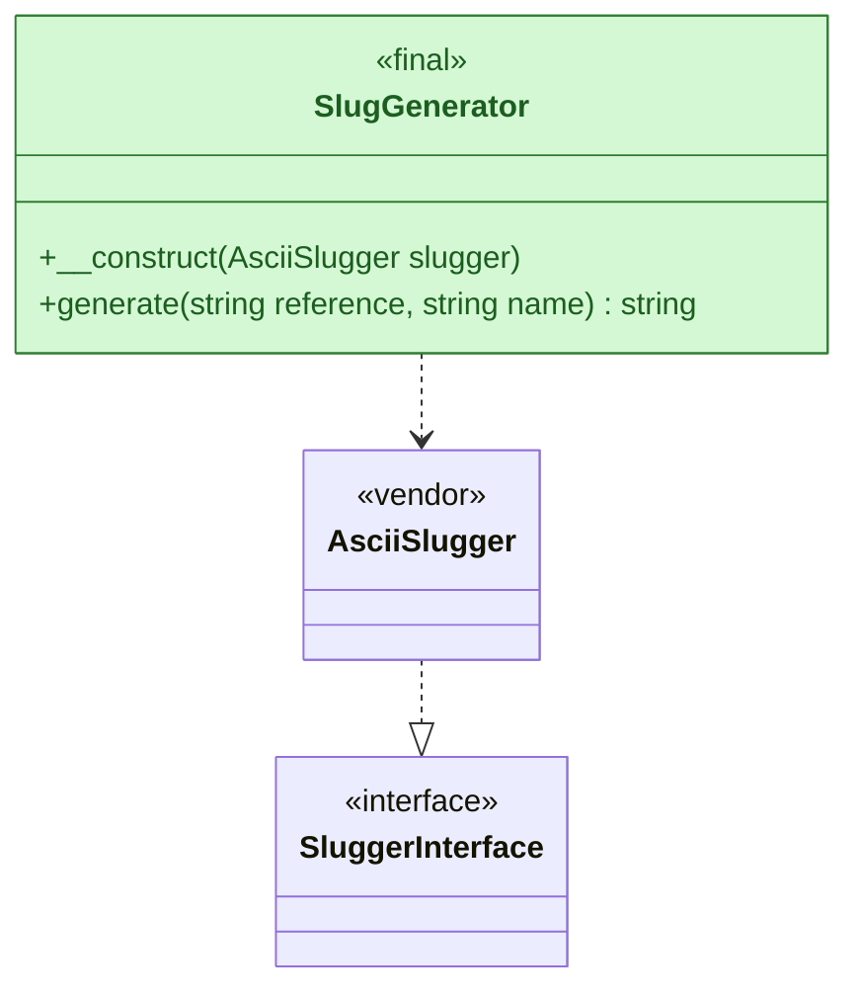

`SlugGenerator` is a standalone class; the vendor `AsciiSlugger implements SluggerInterface` (also `LocaleAwareInterface`).

| Method | IN | Output | Description |
|---|---|---|---|
| `generate()` | `string $reference, string $name` | `string` | Lowercase ASCII slug of `<reference> <name>`. |

#### TA-WRITER TS3 Subtask4 : Create JsonFileTaRepository with the read methods

##### What
Create `JsonFileTaRepository implements TaRepositoryInterface` with `list()` and `get()`; `TS3 Subtask5` adds the write methods.

##### Why
Documents must be listed and read from `data/analyses/<YYYYMMDD>/<slug>.json` for the API and the UI; the interface is otherwise unimplemented.

##### Where
- `ta-writer/src/Storage/JsonFileTaRepository.php` (new).
- `ta-writer/config/services.yaml` (alias `TaRepositoryInterface` → `JsonFileTaRepository`).

##### How
- [ ] Create `final class JsonFileTaRepository implements TaRepositoryInterface` with `__construct(string $storageDir, AtomicFileWriter $writer, SlugGenerator $slugger)`.
- [ ] Implement `list()` scanning `<storageDir>/*/*.json` (ignore `*.versions/`), sorted by modification time descending, returning `{id, title, reference, updatedAt}`.
- [ ] Implement `get()` decoding the JSON with `JSON_THROW_ON_ERROR`, throwing `DocumentNotFoundException::forId()`.
- [ ] Leave `save()`, `delete()`, `restore()` throwing `\LogicException('not implemented yet')` until `TS3 Subtask5` and `TS4 Subtask5`.
- [ ] Unit tests for `JsonFileTaRepository` read methods on a temp directory.

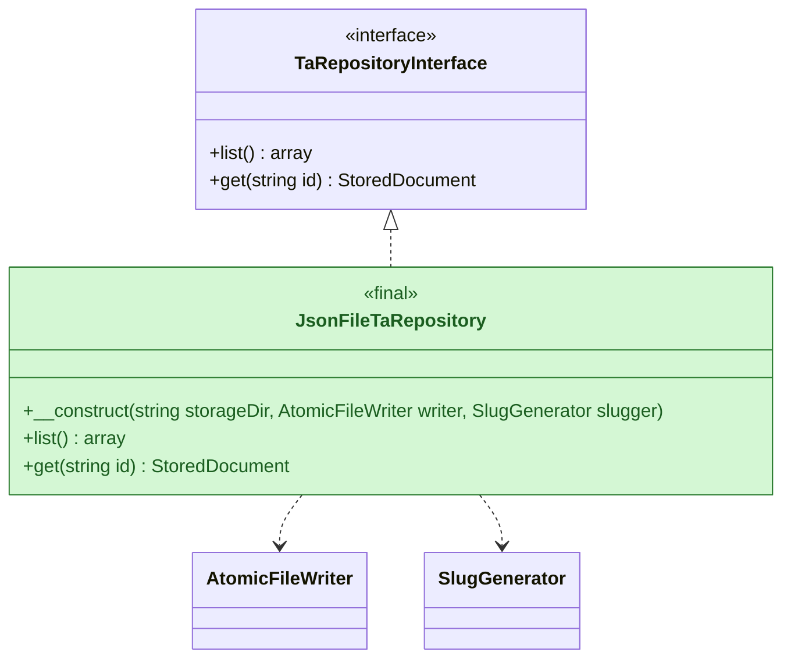

`JsonFileTaRepository implements TaRepositoryInterface`; the interface has no parent.

| Method | IN | Output | Description |
|---|---|---|---|
| `list()` | — | `array` | Summaries of every stored document, newest first. |
| `get()` | `string $id` | `StoredDocument` | Decodes the JSON file or throws `DocumentNotFoundException`. |

#### TA-WRITER TS3 Subtask5 : Add save() and delete()

##### What
Implement `JsonFileTaRepository::save()` (create or replace, atomic) and `delete()`; history is added by `TS4 Subtask3`.

##### Why
Without write methods nothing can be stored; deleting must keep `<slug>.versions/` so a deleted analysis stays recoverable.

##### Where
- `ta-writer/src/Storage/JsonFileTaRepository.php` (changed).

##### How
- [ ] Implement `save()`: when `$id` is empty/new, build the id from `SlugGenerator::generate(project.reference, project.name)` and today's date, add `-2`, `-3` when the file exists; write pretty-printed JSON (`JSON_PRETTY_PRINT | JSON_UNESCAPED_UNICODE | JSON_UNESCAPED_SLASHES`) through `AtomicFileWriter`.
- [ ] Implement `delete()`: remove `<slug>.json` only (the `.versions/` folder is kept).
- [ ] Return the saved `StoredDocument` (`version` = 1 until `TS4 Subtask3`).
- [ ] Unit tests for `save()` (new id, collision suffix, replace) and `delete()` (history folder kept).

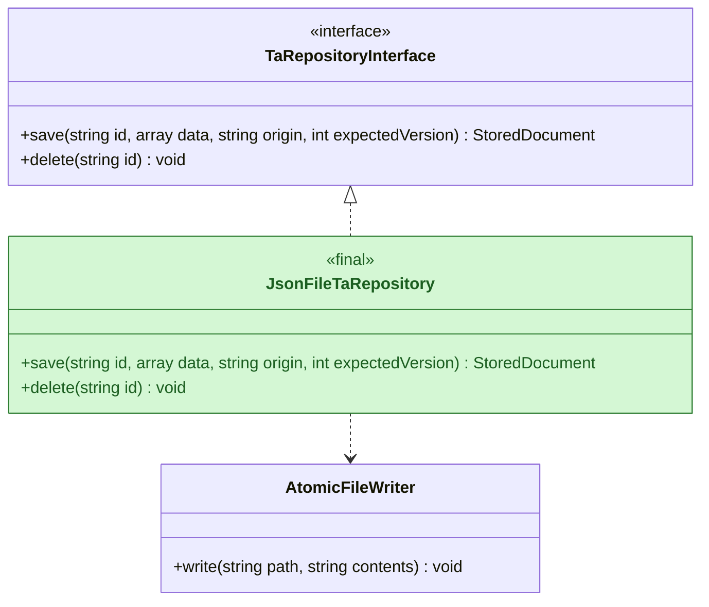

`JsonFileTaRepository implements TaRepositoryInterface` (modified: `save()`, `delete()`).

| Method | IN | Output | Description |
|---|---|---|---|
| `save()` | `string $id, array $data, string $origin, ?int $expectedVersion` | `StoredDocument` | Creates or replaces the JSON file atomically. |
| `delete()` | `string $id` | `void` | Removes the JSON file, keeps the versions folder. |

### TA-WRITER TS4 - Version history

| Subtask | Columns | Rows |
|---|---|---|
| TS4 Subtask1 - Create VersionMeta and VersionStore | — | — |
| TS4 Subtask2 - Add VersionStore::snapshot() | — | — |
| TS4 Subtask3 - Snapshot on every save and reject stale writes | — | — |
| TS4 Subtask4 - Create DocumentDiffer | — | — |
| TS4 Subtask5 - Add restore() | — | — |

#### TA-WRITER TS4 Subtask1 : Create VersionMeta and VersionStore

##### What
Create the `VersionMeta` value object and `VersionStore` with its constructor and the read side (`list()`, `read()`); `TS4 Subtask2` adds `snapshot()`.

##### Why
History lives next to each document in `<slug>.versions/` (`NNNN-<UTC timestamp>.json` + `index.json`); the repository needs one class that owns that layout.

##### Where
- `ta-writer/src/Storage/History/VersionMeta.php`, `VersionStore.php` (new).

##### How
- [ ] Create `VersionMeta` (final readonly): `int $number`, `\DateTimeImmutable $createdAt`, `string $origin` (`ui|api|agir|confluence|restore`), `?string $author`, `array $changedPaths`.
- [ ] Create `final class VersionStore` with `__construct(AtomicFileWriter $writer)`.
- [ ] Add `list(string $versionsDir): array` (reads `index.json`, `[]` when absent) and `read(string $versionsDir, int $number): array` (reads the matching file, throws `DocumentNotFoundException` when missing).
- [ ] Unit tests for `VersionStore` read methods.

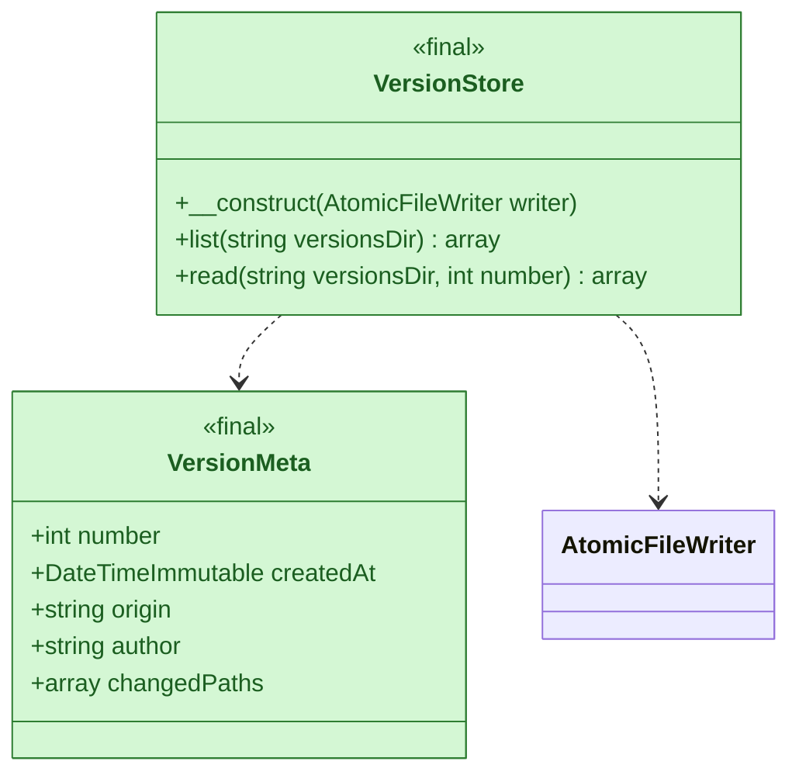

`VersionMeta` and `VersionStore` are standalone classes, no parent or interface.

| Method | IN | Output | Description |
|---|---|---|---|
| `list()` | `string $versionsDir` | `VersionMeta[]` | Versions from `index.json`, oldest first. |
| `read()` | `string $versionsDir, int $number` | `array` | Decoded content of one snapshot. |

#### TA-WRITER TS4 Subtask2 : Add VersionStore::snapshot()

##### What
Add `snapshot()` which stores a full copy of a document as the next version and updates `index.json`.

##### Why
Every write must be recoverable; the snapshot has to be skipped when nothing changed, otherwise a repeated save floods the history.

##### Where
- `ta-writer/src/Storage/History/VersionStore.php` (changed).

##### How
- [ ] Add `snapshot(string $versionsDir, array $data, string $origin, ?string $author): ?VersionMeta` returning `null` when `$data` equals the latest snapshot (compare normalised JSON).
- [ ] Number = last number + 1 (4 digits, `0001`); file `NNNN-<YYYYMMDDTHHMMSSZ>.json`; both the snapshot and `index.json` written through `AtomicFileWriter`.
- [ ] Honour `app.history_max` (TS1 Subtask4): when > 0, delete the oldest snapshots beyond the limit and their index entries.
- [ ] Unit tests for `snapshot()` (first version, unchanged content, numbering, purge limit).

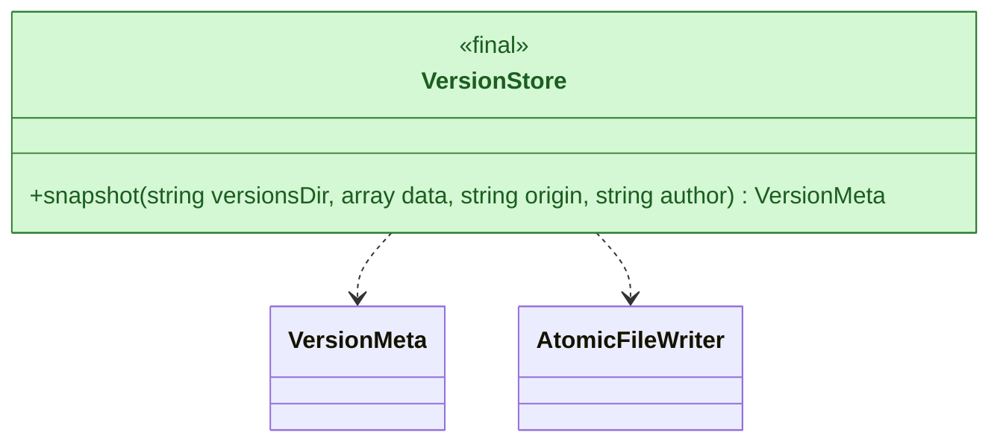

`VersionStore` is a standalone class, no parent or interface; `snapshot()` is (new).

| Method | IN | Output | Description |
|---|---|---|---|
| `snapshot()` | `string $versionsDir, array $data, string $origin, ?string $author` | `?VersionMeta` | Stores the next version, or `null` when unchanged. |

#### TA-WRITER TS4 Subtask3 : Snapshot on every save and reject stale writes

##### What
Make `JsonFileTaRepository::save()` snapshot through `VersionStore` and refuse a write whose `$expectedVersion` is older than the current one; expose `versions()` and `getVersion()`.

##### Why
Without it, history can be bypassed and two writers (UI tab and a running export) silently overwrite each other.

##### Where
- `ta-writer/src/Storage/JsonFileTaRepository.php`, `TaRepositoryInterface.php` (changed).
- `ta-writer/src/Storage/Exception/StaleVersionException.php` (new).

##### How
- [ ] Create `StaleVersionException extends \RuntimeException` with `__construct(int $expected, int $current)`.
- [ ] Inject `VersionStore` and the versions directory helper (`<slug>.versions`) into `JsonFileTaRepository`.
- [ ] In `save()`: when `$expectedVersion !== null` and differs from the current version, throw `StaleVersionException`; otherwise snapshot **before** replacing the file; return `StoredDocument` with the real version.
- [ ] Add `versions(string $id): array` and `getVersion(string $id, int $number): StoredDocument` to the interface and the class.
- [ ] Unit tests for `JsonFileTaRepository::save()` (version increments, no snapshot when unchanged, stale write refused) and `versions()`.

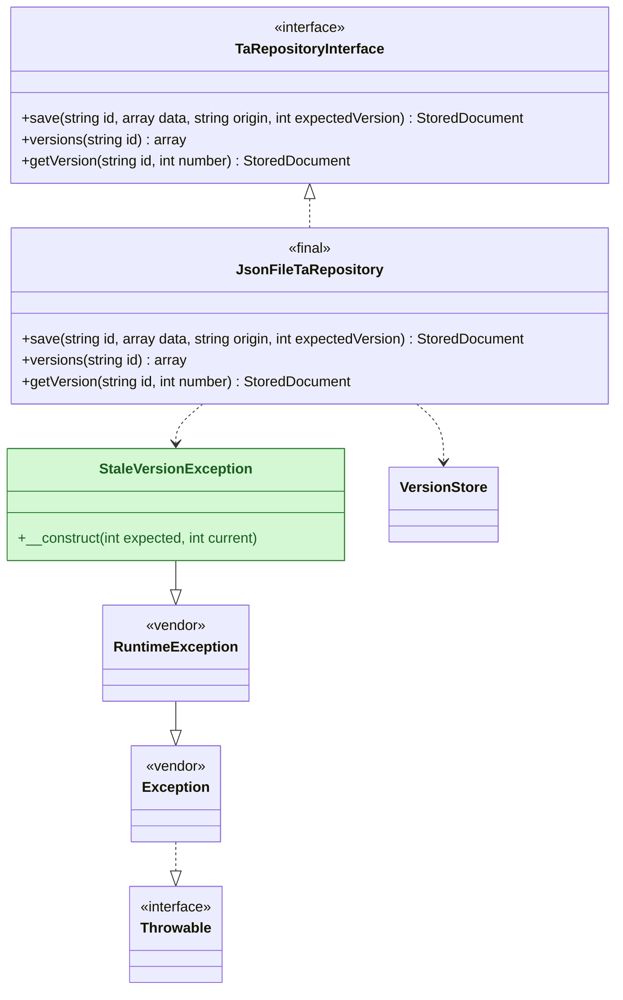

`JsonFileTaRepository implements TaRepositoryInterface` (changed: `save()`; new: `versions()`, `getVersion()`); `StaleVersionException extends \RuntimeException` (`RuntimeException extends Exception implements Throwable`).

| Method | IN | Output | Description |
|---|---|---|---|
| `versions()` | `string $id` | `VersionMeta[]` | History of a document. |
| `getVersion()` | `string $id, int $number` | `StoredDocument` | A past version as a document. |

#### TA-WRITER TS4 Subtask4 : Create DocumentDiffer

##### What
Create the structural diff used for version summaries (`changedPaths`) and for the diff view.

##### Why
The history list must say what changed ("`/epics/0/technicalStories/1/what`") and the UI/API need a diff between any two versions; a text diff of pretty-printed JSON is unreadable once arrays move.

##### Where
- `ta-writer/src/Storage/History/DocumentDiffer.php` (new).
- `ta-writer/src/Storage/History/VersionStore.php` (changed: fills `changedPaths`).

##### How
- [ ] Create `final class DocumentDiffer` with `diff(array $before, array $after): array` returning entries `{path, type: added|removed|changed, before, after}`; paths are JSON Pointers; arrays compared index by index.
- [ ] Add `changedPaths(array $before, array $after): array` returning only the paths (capped at 20, then `…`).
- [ ] Make `VersionStore::snapshot()` call `changedPaths()` against the previous snapshot.
- [ ] Unit tests for `DocumentDiffer` (added/removed/changed, nested, array reorder).

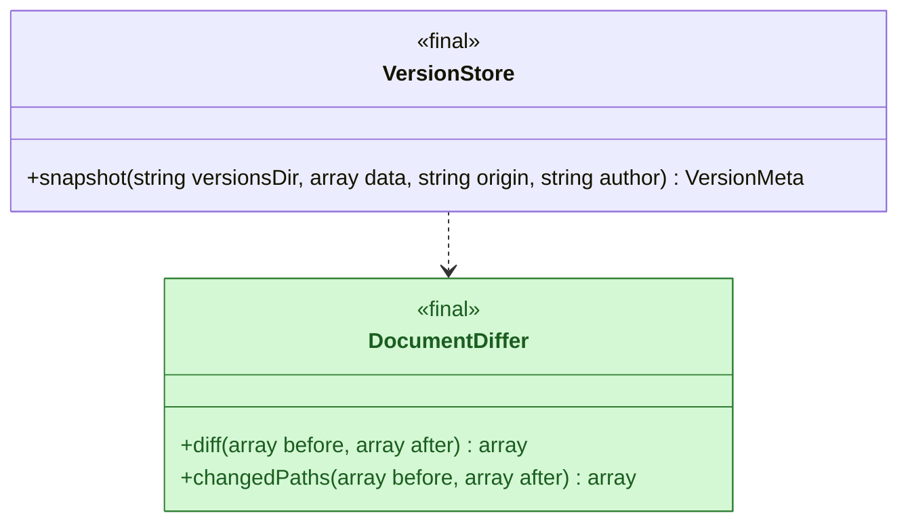

`DocumentDiffer` is a standalone class, no parent or interface; `VersionStore::snapshot()` is (changed).

| Method | IN | Output | Description |
|---|---|---|---|
| `diff()` | `array $before, array $after` | `array` | Added/removed/changed entries by JSON Pointer. |
| `changedPaths()` | `array $before, array $after` | `string[]` | Paths only, for the history summary. |

#### TA-WRITER TS4 Subtask5 : Add restore()

##### What
Implement `JsonFileTaRepository::restore()`: copy a past version as a **new** current version.

##### Why
Going back must never rewrite or delete history; a restore is itself recorded (origin `restore`) so it can be undone.

##### Where
- `ta-writer/src/Storage/JsonFileTaRepository.php` (changed).

##### How
- [ ] Implement `restore(string $id, int $version, string $origin)`: read the snapshot, call `save()` with the current version as `$expectedVersion`.
- [ ] Throw `DocumentNotFoundException` when the version does not exist.
- [ ] Unit tests for `restore()` (restore v1 after v3 creates v4 identical to v1; history untouched).

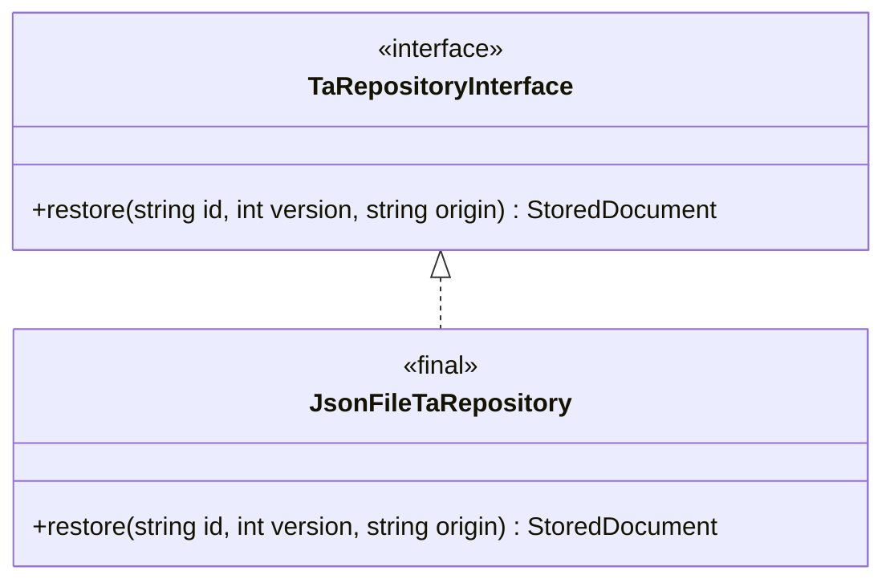

`JsonFileTaRepository implements TaRepositoryInterface` (changed: `restore()`, no new class).

| Method | IN | Output | Description |
|---|---|---|---|
| `restore()` | `string $id, int $version, string $origin` | `StoredDocument` | Saves the old version as a new version. |

### TA-WRITER TS5 - REST API

| Subtask | Columns | Rows |
|---|---|---|
| TS5 Subtask1 - Create ApiExceptionSubscriber | — | — |
| TS5 Subtask2 - Create DocumentController with the read endpoints | — | — |
| TS5 Subtask3 - Add the create, replace and delete endpoints | — | — |
| TS5 Subtask4 - Add the JSON Patch endpoint | — | — |
| TS5 Subtask5 - Create SchemaController | — | — |
| TS5 Subtask6 - Create VersionController | — | — |

#### TA-WRITER TS5 Subtask1 : Create ApiExceptionSubscriber

##### What
Create the subscriber that turns domain exceptions into RFC 7807 `application/problem+json` responses for `/api/*`.

##### Why
Without it a missing document is a 500 and the schema errors never reach the caller; clients (UI, external tools) rely on 404 / 409 / 422 with a machine-readable body.

##### Where
- `ta-writer/src/Api/EventSubscriber/ApiExceptionSubscriber.php` (new).

##### How
- [ ] Create `final class ApiExceptionSubscriber implements EventSubscriberInterface` subscribing to `KernelEvents::EXCEPTION`.
- [ ] Only act when the request path starts with `/api/`.
- [ ] Map `DocumentNotFoundException` → 404, `SchemaValidationException` → 422 (`errors` extension), `StaleVersionException` → 409 (`expected`, `current`), `\InvalidArgumentException` → 400; anything else is left to Symfony.
- [ ] Unit tests for `ApiExceptionSubscriber::onKernelException()` (one case per mapping, non-API path ignored).

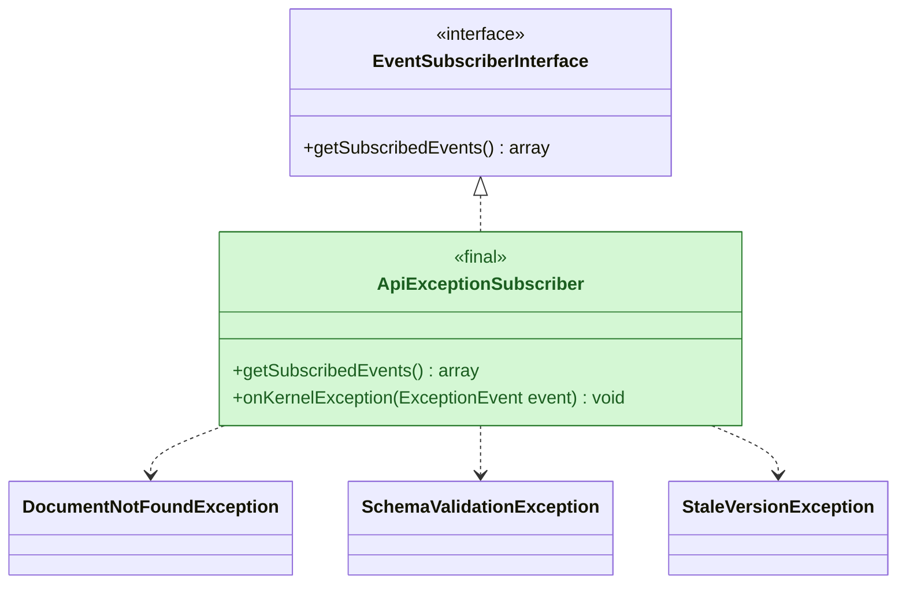

`ApiExceptionSubscriber implements EventSubscriberInterface` (no parent class).

| Method | IN | Output | Description |
|---|---|---|---|
| `getSubscribedEvents()` (static) | — | `array` | Subscribes to `kernel.exception`. |
| `onKernelException()` | `ExceptionEvent $event` | `void` | Replaces the response by a problem+json one. |

#### TA-WRITER TS5 Subtask2 : Create DocumentController with the read endpoints

##### What
Create `DocumentController` with `GET /api/documents` and `GET /api/documents/{id}`; the write endpoints come in `TS5 Subtask3` and `Subtask4`.

##### Why
API clients (and the UI) need to list and read documents before they can edit them; the `ETag` carries the version used by later conditional writes.

##### Where
- `ta-writer/src/Api/Controller/DocumentController.php` (new).

##### How
- [ ] Create `final class DocumentController extends AbstractController` with `__construct(TaRepositoryInterface $repository)`.
- [ ] Add `list()` (`GET /api/documents`) returning `repository->list()`.
- [ ] Add `show()` (`GET /api/documents/{id}`) returning `data` with header `ETag: "<version>"`.
- [ ] Unit/functional tests for both routes (empty list, existing document, 404 through the subscriber).

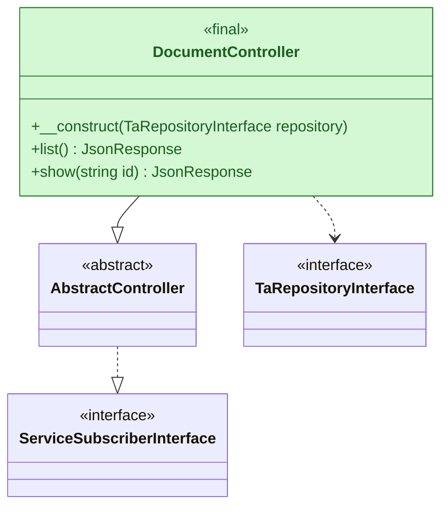

`DocumentController extends AbstractController` (`AbstractController implements ServiceSubscriberInterface`).

| Method | IN | Output | Description |
|---|---|---|---|
| `list()` | — | `JsonResponse` | Summaries of all documents. |
| `show()` | `string $id` | `JsonResponse` | One document with its `ETag`. |

#### TA-WRITER TS5 Subtask3 : Add the create, replace and delete endpoints

##### What
Add `POST /api/documents`, `PUT /api/documents/{id}` (with `If-Match`) and `DELETE /api/documents/{id}` to `DocumentController`.

##### Why
External tools inject analyses through these routes; schema validation must run before anything is stored, and `If-Match` prevents overwriting a newer version.

##### Where
- `ta-writer/src/Api/Controller/DocumentController.php` (changed).

##### How
- [ ] Add `create()` (`POST`): decode JSON, `SchemaValidator::validate()`, `save()` with origin `api`, answer `201` with `Location` and `ETag`.
- [ ] Add `replace()` (`PUT`): read `If-Match` as `expectedVersion` (428 when absent), validate, save.
- [ ] Add `delete()` (`DELETE`): `204`.
- [ ] Inject `SchemaValidator` in the constructor.
- [ ] Unit/functional tests for the three routes (valid, invalid schema → 422, stale `If-Match` → 409).

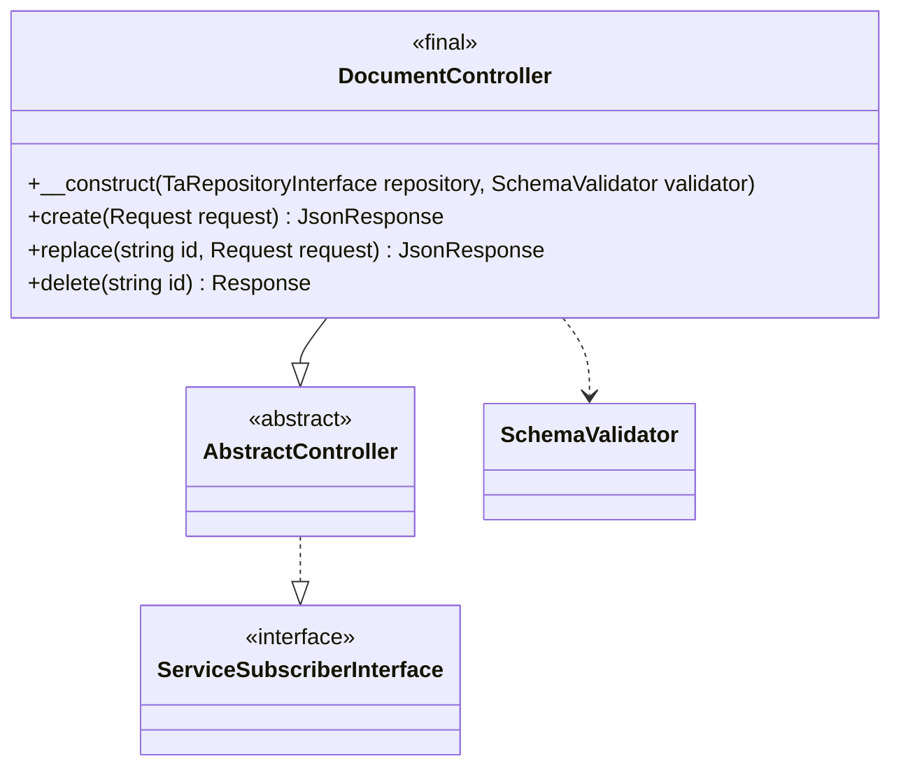

`DocumentController extends AbstractController` (changed: constructor, `create()`, `replace()`, `delete()` are new).

| Method | IN | Output | Description |
|---|---|---|---|
| `create()` | `Request $request` | `JsonResponse` | Validates and stores a new document (201). |
| `replace()` | `string $id, Request $request` | `JsonResponse` | Replaces a document if `If-Match` is current. |
| `delete()` | `string $id` | `Response` | Deletes the current file (204). |

#### TA-WRITER TS5 Subtask4 : Add the JSON Patch endpoint

##### What
Add `PATCH /api/documents/{id}` accepting `application/json-patch+json` (RFC 6902) so epics, technical stories, subtasks can be created, edited, deleted and reordered with `add` / `remove` / `replace` / `move`.

##### Why
A generic patch covers CRUD and reordering of any node, including properties added to the YAML later, without one endpoint per node type.

##### Where
- `ta-writer/src/Api/JsonPatchApplier.php` (new).
- `ta-writer/src/Api/Controller/DocumentController.php` (changed).

##### How
- [ ] Create `final class JsonPatchApplier` with `apply(array $document, array $operations): array` supporting `add`, `remove`, `replace`, `move`, `copy`, `test`; throw `\InvalidArgumentException` on an invalid pointer/operation (→ 400).
- [ ] Use a maintained RFC 6902 library if one installs on PHP 8.1 (to confirm), otherwise implement the six operations (~80 lines).
- [ ] Add `patch()` in `DocumentController`: apply, validate with `SchemaValidator`, save with `If-Match`.
- [ ] Unit tests for `JsonPatchApplier` (each operation, array reordering with `move`, bad pointer) and a route test for `patch()`.

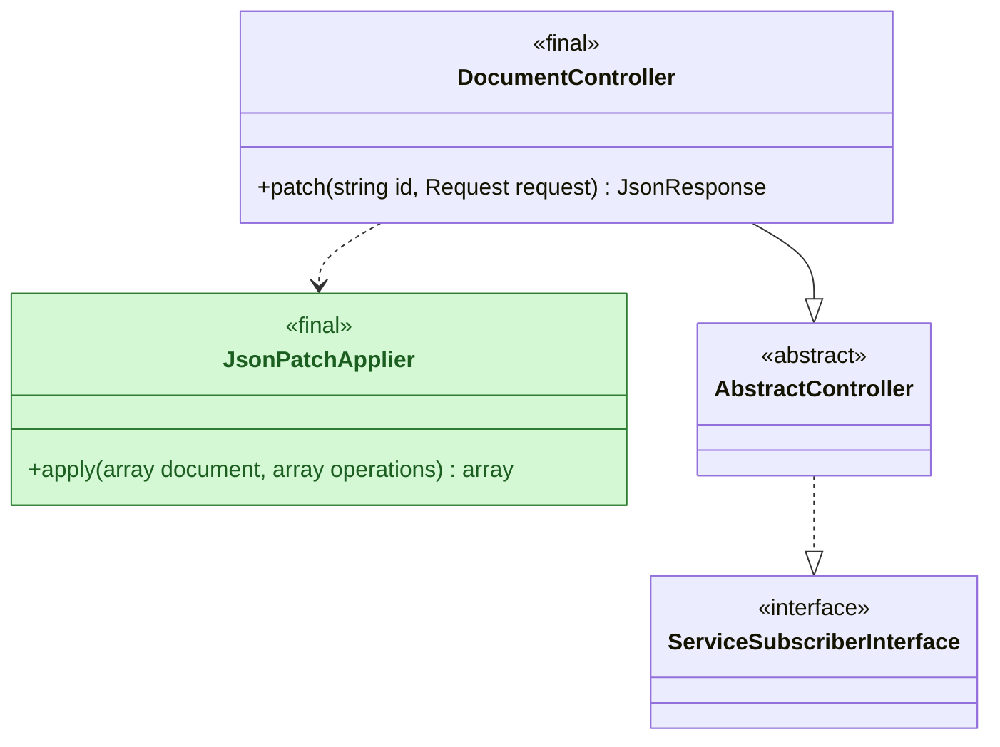

`JsonPatchApplier` is a standalone class, no parent or interface; `DocumentController extends AbstractController` (changed: `patch()`).

| Method | IN | Output | Description |
|---|---|---|---|
| `apply()` | `array $document, array $operations` | `array` | Document after the RFC 6902 operations. |
| `patch()` | `string $id, Request $request` | `JsonResponse` | Applies, validates and saves a patch. |

#### TA-WRITER TS5 Subtask5 : Create SchemaController

##### What
Create `SchemaController` publishing the resolved JSON Schema (`GET /api/schema`) and the raw OpenAPI YAML (`GET /api/openapi`).

##### Why
External tools and AIs must know the exact structure to inject documents; the YAML is also the public contract of this API.

##### Where
- `ta-writer/src/Api/Controller/SchemaController.php` (new).

##### How
- [ ] Create `final class SchemaController extends AbstractController` with `__construct(SchemaProvider $provider, string $schemaPath)`.
- [ ] Add `jsonSchema()` returning `getDocumentJsonSchema()` as JSON.
- [ ] Add `openApi()` returning the raw file with `Content-Type: application/yaml`.
- [ ] Unit/functional tests for both routes.

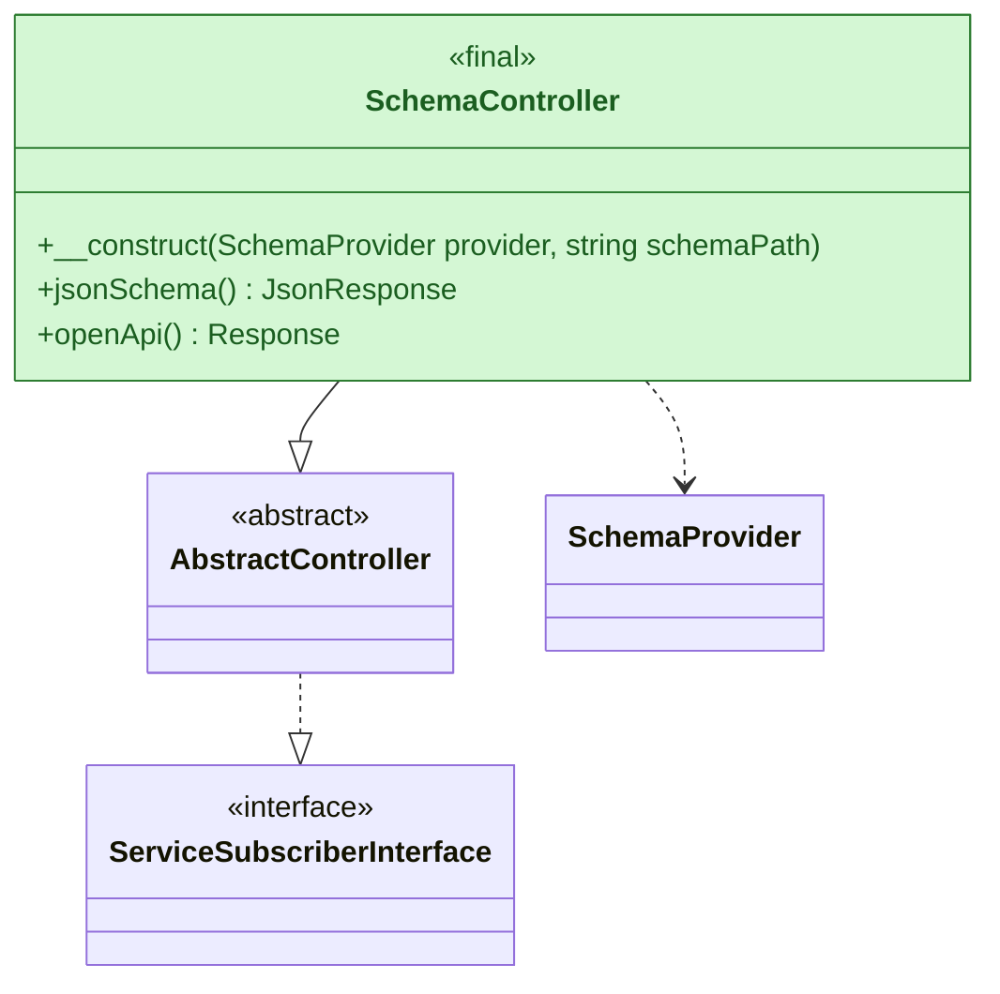

`SchemaController extends AbstractController` (`AbstractController implements ServiceSubscriberInterface`).

| Method | IN | Output | Description |
|---|---|---|---|
| `jsonSchema()` | — | `JsonResponse` | Resolved `Document` JSON Schema. |
| `openApi()` | — | `Response` | Raw OpenAPI YAML. |

#### TA-WRITER TS5 Subtask6 : Create VersionController

##### What
Create `VersionController` with list, read, diff and restore endpoints for the history.

##### Why
The UI versions panel and external tools need to browse and restore versions through the API (AC3).

##### Where
- `ta-writer/src/Api/Controller/VersionController.php` (new).

##### How
- [ ] Create `final class VersionController extends AbstractController` with `__construct(TaRepositoryInterface $repository, DocumentDiffer $differ)`.
- [ ] Add `list()` (`GET /api/documents/{id}/versions`), `show()` (`…/versions/{n}`), `diff()` (`…/versions/{a}/diff/{b}`), `restore()` (`POST …/versions/{n}/restore`, origin `restore`).
- [ ] Unit/functional tests for the four routes (restore creates a new version).

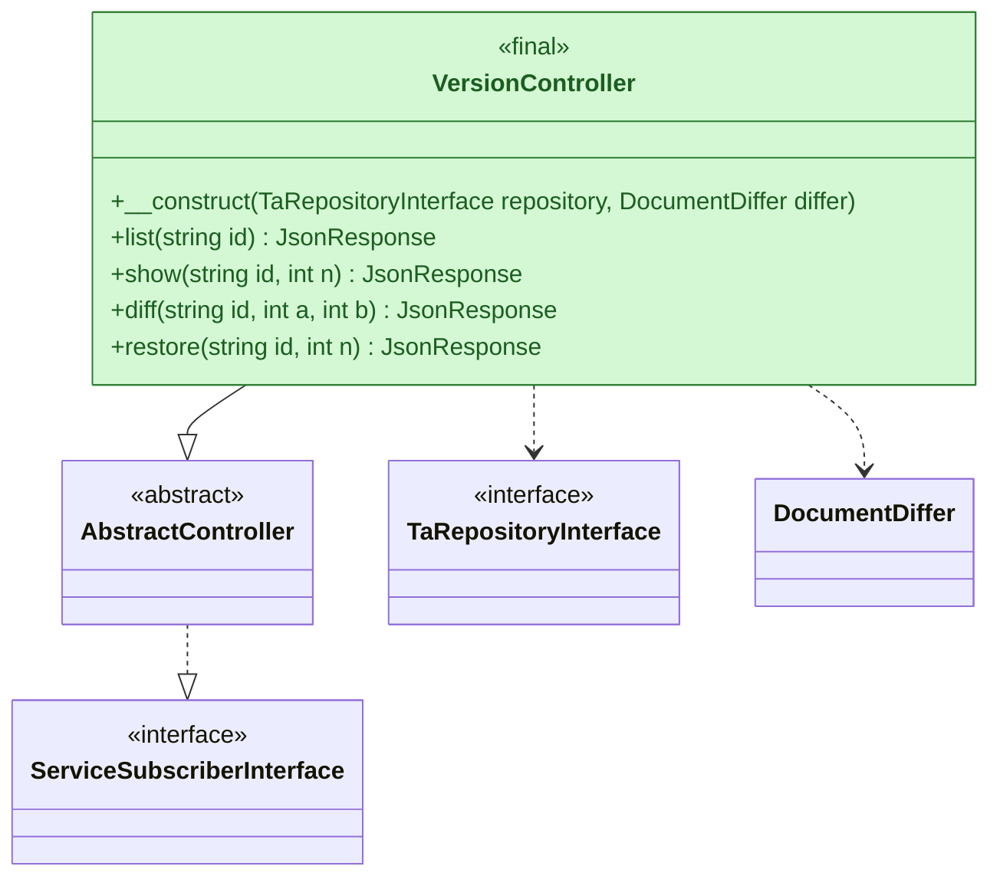

`VersionController extends AbstractController` (`AbstractController implements ServiceSubscriberInterface`).

| Method | IN | Output | Description |
|---|---|---|---|
| `list()` | `string $id` | `JsonResponse` | History of a document. |
| `show()` | `string $id, int $n` | `JsonResponse` | One past version. |
| `diff()` | `string $id, int $a, int $b` | `JsonResponse` | Structural diff between two versions. |
| `restore()` | `string $id, int $n` | `JsonResponse` | Restores a version as a new one. |

### TA-WRITER TS6 - Business validation

| Subtask | Columns | Rows |
|---|---|---|
| TS6 Subtask1 - Create the validation contracts | — | — |
| TS6 Subtask2 - Add UniqueReferenceRule | — | — |
| TS6 Subtask3 - Add DependencyCycleRule | — | — |
| TS6 Subtask4 - Add AcceptanceCriteriaCoverageRule | — | — |
| TS6 Subtask5 - Wire BusinessValidator into the API | — | — |

#### TA-WRITER TS6 Subtask1 : Create the validation contracts

##### What
Create `Violation`, `RuleInterface`, `BusinessValidator` and `BusinessValidationException`.

##### Why
Schema validation cannot express cross-node rules (duplicate references, cycles); rules need one extension point so adding a rule is one class.

##### Where
- `ta-writer/src/Validation/Violation.php`, `RuleInterface.php`, `BusinessValidator.php`, `BusinessValidationException.php` (new).
- `ta-writer/config/services.yaml` (autoconfigure tag `app.validation_rule` on `RuleInterface`).

##### How
- [ ] Create `Violation` (final readonly): `string $rule`, `string $path`, `string $message`, `string $severity` (`error|warning`).
- [ ] Create `RuleInterface` with `check(array $document): array` (list of `Violation`).
- [ ] Create `BusinessValidator` with `__construct(iterable $rules)` (tagged iterator), `validate(array $document): array` and `assertValid(array $document): void` (throws on any `error`).
- [ ] Create `BusinessValidationException extends \RuntimeException` with `getViolations(): array`.
- [ ] Unit tests for `BusinessValidator` (no rules, warning only does not throw, error throws).

```mermaid
classDiagram
    class RuleInterface {
        <<interface>>
        +check(array document) array
    }
    class BusinessValidator {
        <<final>>
        +__construct(iterable rules)
        +validate(array document) array
        +assertValid(array document) void
    }
    class Violation {
        <<final>>
        +string rule
        +string path
        +string message
        +string severity
    }
    class BusinessValidationException {
        +getViolations() array
    }
    class RuntimeException {
        <<vendor>>
    }
    class Exception {
        <<vendor>>
    }
    class Throwable {
        <<interface>>
        <<vendor>>
    }
    BusinessValidationException --|> RuntimeException
    RuntimeException --|> Exception
    Exception ..|> Throwable
    BusinessValidator o-- RuleInterface
    RuleInterface ..> Violation
    BusinessValidator ..> BusinessValidationException
    style RuleInterface fill:#d4f7d4,stroke:#2e7d32,color:#1b5e20
    style BusinessValidator fill:#d4f7d4,stroke:#2e7d32,color:#1b5e20
    style Violation fill:#d4f7d4,stroke:#2e7d32,color:#1b5e20
    style BusinessValidationException fill:#d4f7d4,stroke:#2e7d32,color:#1b5e20
```

`BusinessValidationException extends \RuntimeException` (`RuntimeException extends Exception implements Throwable`); `Violation` and `BusinessValidator` are standalone; `RuleInterface` has no parent.

| Method | IN | Output | Description |
|---|---|---|---|
| `validate()` | `array $document` | `Violation[]` | Runs every rule. |
| `assertValid()` | `array $document` | `void` | Throws when at least one `error` exists. |

#### TA-WRITER TS6 Subtask2 : Add UniqueReferenceRule

##### What
Add the rule rejecting two epics, user stories, technical stories or subtasks with the same reference at the same level.

##### Why
Duplicated references produce duplicated Confluence titles (the title starts with the reference) and ambiguous `dependencies` targets.

##### Where
- `ta-writer/src/Validation/Rule/UniqueReferenceRule.php` (new).

##### How
- [ ] Create `final class UniqueReferenceRule implements RuleInterface`.
- [ ] Implement `check()`: epics unique in the document; user stories and technical stories unique inside their epic (together: `US1` and `TS1` may coexist, two `TS1` may not); subtasks unique inside their technical story; empty references are skipped (generated by `ReferenceResolver`).
- [ ] Unit tests for `UniqueReferenceRule` (duplicates at each level, same reference in two epics allowed).

```mermaid
classDiagram
    class RuleInterface {
        <<interface>>
        +check(array document) array
    }
    class UniqueReferenceRule {
        <<final>>
        +check(array document) array
    }
    RuleInterface <|.. UniqueReferenceRule
    style UniqueReferenceRule fill:#d4f7d4,stroke:#2e7d32,color:#1b5e20
```

`UniqueReferenceRule implements RuleInterface`; the interface has no parent.

| Method | IN | Output | Description |
|---|---|---|---|
| `check()` | `array $document` | `Violation[]` | One `error` per duplicated reference. |

#### TA-WRITER TS6 Subtask3 : Add DependencyCycleRule

##### What
Add the rule checking that every `dependencies[].from/to` references an existing item and that the graph has no cycle or self-reference.

##### Why
A cycle makes the Jira `Blocks` links impossible to honour and an unknown reference makes `apply` fail late.

##### Where
- `ta-writer/src/Validation/Rule/DependencyCycleRule.php` (new).

##### How
- [ ] Create `final class DependencyCycleRule implements RuleInterface`.
- [ ] Resolve `from`/`to` against epic, user-story, technical-story references (and full references); an unknown one is an `error`.
- [ ] Detect self-references and cycles with a depth-first search; report the cycle path.
- [ ] Unit tests for `DependencyCycleRule` (unknown reference, self-reference, 3-node cycle, valid DAG).

```mermaid
classDiagram
    class RuleInterface {
        <<interface>>
        +check(array document) array
    }
    class DependencyCycleRule {
        <<final>>
        +check(array document) array
    }
    RuleInterface <|.. DependencyCycleRule
    style DependencyCycleRule fill:#d4f7d4,stroke:#2e7d32,color:#1b5e20
```

`DependencyCycleRule implements RuleInterface`; the interface has no parent.

| Method | IN | Output | Description |
|---|---|---|---|
| `check()` | `array $document` | `Violation[]` | Errors for unknown references, self-loops and cycles. |

#### TA-WRITER TS6 Subtask4 : Add AcceptanceCriteriaCoverageRule

##### What
Add the rule warning when a user-story acceptance criterion is not listed in any `acceptanceCriteriaCovered`, or a covered criterion matches no user story.

##### Why
A criterion nobody covers is a hole in the analysis; a covered criterion that does not exist is a typo. It is a warning because user stories are optional in the schema.

##### Where
- `ta-writer/src/Validation/Rule/AcceptanceCriteriaCoverageRule.php` (new).

##### How
- [ ] Create `final class AcceptanceCriteriaCoverageRule implements RuleInterface` returning `warning` violations.
- [ ] Compare strings after trimming and whitespace normalisation across all epics (technical stories may cover criteria of another epic).
- [ ] Unit tests for `AcceptanceCriteriaCoverageRule` (uncovered, unknown, fully covered, no user stories).

```mermaid
classDiagram
    class RuleInterface {
        <<interface>>
        +check(array document) array
    }
    class AcceptanceCriteriaCoverageRule {
        <<final>>
        +check(array document) array
    }
    RuleInterface <|.. AcceptanceCriteriaCoverageRule
    style AcceptanceCriteriaCoverageRule fill:#d4f7d4,stroke:#2e7d32,color:#1b5e20
```

`AcceptanceCriteriaCoverageRule implements RuleInterface`; the interface has no parent.

| Method | IN | Output | Description |
|---|---|---|---|
| `check()` | `array $document` | `Violation[]` | Warnings for uncovered or unknown criteria. |

#### TA-WRITER TS6 Subtask5 : Wire BusinessValidator into the API

##### What
Make the write endpoints call `BusinessValidator::assertValid()`, map `BusinessValidationException` to 422, and add `POST /api/documents/{id}/validate` returning every violation.

##### Why
The rules are useless unless a bad document is refused at the door (AC12); warnings must stay visible without blocking.

##### Where
- `ta-writer/src/Api/Controller/DocumentController.php` (changed: `create()`, `replace()`, `patch()`, new `validate()`).
- `ta-writer/src/Api/EventSubscriber/ApiExceptionSubscriber.php` (changed).

##### How
- [ ] Inject `BusinessValidator` in `DocumentController` and call `assertValid()` after the schema validation in the three write routes.
- [ ] Add `validate()` (`POST /api/documents/{id}/validate`) returning `{errors: […], warnings: […]}` without saving.
- [ ] Map `BusinessValidationException` → 422 with a `violations` extension in `ApiExceptionSubscriber`.
- [ ] Unit/functional tests for the 422 case and the `validate` route.

```mermaid
classDiagram
    class DocumentController {
        <<final>>
        +__construct(TaRepositoryInterface repository, SchemaValidator validator, BusinessValidator business)
        +validate(string id) JsonResponse
    }
    class AbstractController {
        <<abstract>>
        <<vendor>>
    }
    class ServiceSubscriberInterface {
        <<interface>>
        <<vendor>>
    }
    class ApiExceptionSubscriber {
        <<final>>
        +onKernelException(ExceptionEvent event) void
    }
    class EventSubscriberInterface {
        <<interface>>
        <<vendor>>
    }
    class BusinessValidator
    DocumentController --|> AbstractController
    AbstractController ..|> ServiceSubscriberInterface
    EventSubscriberInterface <|.. ApiExceptionSubscriber
    DocumentController ..> BusinessValidator
```

`DocumentController extends AbstractController` (changed: constructor, new `validate()`); `ApiExceptionSubscriber implements EventSubscriberInterface` (changed: new mapping).

| Method | IN | Output | Description |
|---|---|---|---|
| `validate()` | `string $id` | `JsonResponse` | Errors and warnings of the stored document. |

### TA-WRITER TS7 - References and document render model

| Subtask | Columns | Rows |
|---|---|---|
| TS7 Subtask1 - Create ReferenceResolver | — | — |
| TS7 Subtask2 - Create ContentConverter | — | — |
| TS7 Subtask3 - Create the render model value objects | — | — |
| TS7 Subtask4 - Create DocumentModelBuilder | — | — |
| TS7 Subtask5 - Add the calculated sections | — | — |

#### TA-WRITER TS7 Subtask1 : Create ReferenceResolver

##### What
Create the service that builds the top-to-bottom reference of each level and the displayed title `<reference> - <title>`.

##### Why
Every output (PDF, Markdown, Confluence titles, UI) must show `<project> <epic> <ts> <subtask> - <title>`; centralising it avoids four slightly different implementations and keeps Confluence titles unique.

##### Where
- `ta-writer/src/Reference/ReferenceResolver.php` (new).

##### How
- [ ] Create `final class ReferenceResolver` with `epic(array $document, int $e): string`, `userStory(array $document, int $e, int $u): string`, `technicalStory(array $document, int $e, int $t): string`, `subtask(array $document, int $e, int $t, int $s): string`, `title(string $reference, string $title): string`.
- [ ] Concatenate the non-empty segments with one space: `project.reference`, `epic.reference`, then the `userStory`/`technicalStory` reference, then `subtask.reference`; references are used as stored (`E3`, `TS3`, `Subtask#1`), never transformed.
- [ ] A missing reference is generated by position (`E<n>`, `US<n>`, `TS<n>`, `Subtask#<n>`, 1-based); a missing `project.reference` is simply omitted.
- [ ] `title()` returns `"<reference> - <title>"`.
- [ ] Unit tests for `ReferenceResolver` on the four levels: `ITC1615 E3 - …`, `ITC1615 E3 US1 - …`, `ITC1615 E3 TS3 - …`, `ITC1615 E3 TS3 Subtask#1 - …`, plus missing segments.

```mermaid
classDiagram
    class ReferenceResolver {
        <<final>>
        +epic(array document, int e) string
        +userStory(array document, int e, int u) string
        +technicalStory(array document, int e, int t) string
        +subtask(array document, int e, int t, int s) string
        +title(string reference, string title) string
    }
    style ReferenceResolver fill:#d4f7d4,stroke:#2e7d32,color:#1b5e20
```

`ReferenceResolver` is a standalone class, no parent or interface.

| Method | IN | Output | Description |
|---|---|---|---|
| `epic()` | `array $document, int $e` | `string` | `<project> <epic>`. |
| `userStory()` | `array $document, int $e, int $u` | `string` | `<project> <epic> <us>`. |
| `technicalStory()` | `array $document, int $e, int $t` | `string` | `<project> <epic> <ts>`. |
| `subtask()` | `array $document, int $e, int $t, int $s` | `string` | `<project> <epic> <ts> <subtask>`. |
| `title()` | `string $reference, string $title` | `string` | `<reference> - <title>`. |

#### TA-WRITER TS7 Subtask2 : Create ContentConverter

##### What
Create the service that converts a text field to HTML or Markdown according to the document `format` (`html`, `text`, `markdown`).

##### Why
The `format` field says how `what`/`why`/`how` are written; PDF and Confluence need HTML, the Markdown export needs Markdown, and untrusted HTML must not reach the PDF or Confluence unsanitised.

##### Where
- `ta-writer/src/Render/ContentConverter.php` (new).

##### How
- [ ] Create `final class ContentConverter` with `__construct(GithubFlavoredMarkdownConverter $markdown, HtmlSanitizerInterface $sanitizer, HtmlConverter $htmlToMarkdown)`.
- [ ] Add `toHtml(string $content, string $format): string`: markdown → CommonMark (HTML input escaped), html → sanitised, text → escaped with `nl2br`.
- [ ] Add `toMarkdown(string $content, string $format): string`: markdown unchanged, html → `league/html-to-markdown`, text unchanged.
- [ ] Preserve fenced code blocks and task lists (`- [ ]`) in both directions.
- [ ] Unit tests for `ContentConverter` (each format, script tag removed, code fences, checklist).

```mermaid
classDiagram
    class ContentConverter {
        <<final>>
        +__construct(GithubFlavoredMarkdownConverter markdown, HtmlSanitizerInterface sanitizer, HtmlConverter htmlToMarkdown)
        +toHtml(string content, string format) string
        +toMarkdown(string content, string format) string
    }
    class HtmlSanitizerInterface {
        <<interface>>
        <<vendor>>
    }
    class GithubFlavoredMarkdownConverter {
        <<vendor>>
    }
    class MarkdownConverter {
        <<vendor>>
    }
    class ConverterInterface {
        <<interface>>
        <<vendor>>
    }
    GithubFlavoredMarkdownConverter --|> MarkdownConverter
    MarkdownConverter ..|> ConverterInterface
    ContentConverter ..> GithubFlavoredMarkdownConverter
    ContentConverter ..> HtmlSanitizerInterface
    style ContentConverter fill:#d4f7d4,stroke:#2e7d32,color:#1b5e20
```

`ContentConverter` is a standalone class; the vendor `GithubFlavoredMarkdownConverter extends MarkdownConverter implements ConverterInterface` (also `MarkdownConverterInterface`).

| Method | IN | Output | Description |
|---|---|---|---|
| `toHtml()` | `string $content, string $format` | `string` | Safe HTML. |
| `toMarkdown()` | `string $content, string $format` | `string` | Markdown text. |

#### TA-WRITER TS7 Subtask3 : Create the render model value objects

##### What
Create the readonly value objects that every renderer consumes: `DocumentModel`, `EpicModel`, `UserStoryModel`, `TechnicalStoryModel`, `SubtaskModel`.

##### Why
PDF, Markdown and Confluence must render the same data; one model avoids each adapter re-reading the raw JSON and recomputing references.

##### Where
- `ta-writer/src/Render/Model/DocumentModel.php`, `EpicModel.php`, `UserStoryModel.php`, `TechnicalStoryModel.php`, `SubtaskModel.php` (new).

##### How
- [ ] Create the five classes as `final readonly` with public constructor-promoted properties; every node carries `string $displayTitle` (reference + title), `string $reference`, `?string $ticket`, `?string $pageLink`, `array $resources`, `array $diagrams`.
- [ ] `EpicModel`: `what`, `userStories`, `technicalStories`; `TechnicalStoryModel`: `what`, `why`, `acceptanceCriteriaCovered`, `subtasks`; `SubtaskModel`: `what`, `why`, `where`, `how`, `criterion`, `featureToggle`, `sqlImpact`.
- [ ] `DocumentModel`: `project`, `author`, `version`, `structureVersion`, `format`, `epics`, and the calculated tables added by `TS7 Subtask5` (`dependencies`, `acCoverage`, `sqlImpact`).
- [ ] No unit tests (data classes without behaviour), they are covered through `TS7 Subtask4`.

```mermaid
classDiagram
    class DocumentModel {
        <<final>>
        +array project
        +array author
        +array epics
        +array dependencies
        +array acCoverage
        +array sqlImpact
    }
    class EpicModel {
        <<final>>
        +string displayTitle
        +string what
        +array userStories
        +array technicalStories
    }
    class UserStoryModel {
        <<final>>
        +string displayTitle
        +array acceptanceCriteria
    }
    class TechnicalStoryModel {
        <<final>>
        +string displayTitle
        +string what
        +string why
        +array subtasks
    }
    class SubtaskModel {
        <<final>>
        +string displayTitle
        +string what
        +string why
        +string where
        +string how
        +string featureToggle
        +array sqlImpact
    }
    DocumentModel o-- EpicModel
    EpicModel o-- UserStoryModel
    EpicModel o-- TechnicalStoryModel
    TechnicalStoryModel o-- SubtaskModel
    style DocumentModel fill:#d4f7d4,stroke:#2e7d32,color:#1b5e20
    style EpicModel fill:#d4f7d4,stroke:#2e7d32,color:#1b5e20
    style UserStoryModel fill:#d4f7d4,stroke:#2e7d32,color:#1b5e20
    style TechnicalStoryModel fill:#d4f7d4,stroke:#2e7d32,color:#1b5e20
    style SubtaskModel fill:#d4f7d4,stroke:#2e7d32,color:#1b5e20
```

All five are standalone final readonly classes, no parent or interface.

#### TA-WRITER TS7 Subtask4 : Create DocumentModelBuilder

##### What
Create `DocumentModelBuilder::build()` turning the validated JSON into a `DocumentModel` for one to n epics.

##### Why
Every adapter calls it, so references, content conversion and the 1-to-n epic loop exist once (AC7, AC10, AC11).

##### Where
- `ta-writer/src/Render/DocumentModelBuilder.php` (new).

##### How
- [ ] Create `final class DocumentModelBuilder` with `__construct(ReferenceResolver $references)`.
- [ ] Add `build(array $document): DocumentModel` iterating `epics[]` (a single epic is a loop of length 1), then `userStories[]`, `technicalStories[]`, `subtasks[]`, filling `displayTitle` through `ReferenceResolver::title()`.
- [ ] Keep text fields raw (the adapters call `ContentConverter` with `$document['format']`); keep unknown schema fields out of the model (adapters only render known fields).
- [ ] Unit tests for `DocumentModelBuilder` (one epic, three epics, missing optional arrays, display titles of the four levels).

```mermaid
classDiagram
    class DocumentModelBuilder {
        <<final>>
        +__construct(ReferenceResolver references)
        +build(array document) DocumentModel
    }
    class ReferenceResolver
    class DocumentModel
    DocumentModelBuilder ..> ReferenceResolver
    DocumentModelBuilder ..> DocumentModel
    style DocumentModelBuilder fill:#d4f7d4,stroke:#2e7d32,color:#1b5e20
```

`DocumentModelBuilder` is a standalone class, no parent or interface.

| Method | IN | Output | Description |
|---|---|---|---|
| `build()` | `array $document` | `DocumentModel` | Render model for all epics. |

#### TA-WRITER TS7 Subtask5 : Add the calculated sections

##### What
Extend `DocumentModelBuilder::build()` with three calculated sections: dependencies (with display titles), AC coverage, SQL impact totals.

##### Why
The PDF and Markdown show a dependency table, an AC coverage table and SQL impact tables; they must be computed once from the JSON (`dependencies[]`, `acceptanceCriteria*`, `sqlImpact`), not hand-written.

##### Where
- `ta-writer/src/Render/DocumentModelBuilder.php` (changed).

##### How
- [ ] Add private `buildDependencies()`: for each `{from, to}` resolve both ends to display titles and to the `pageLink` of the matching epic / user story / technical story (`fromLink`, `toLink`, `null` when the JSON has none); unresolved ends keep the raw text.
- [ ] Add private `buildAcCoverage()`: one row per user-story criterion with the technical stories (display titles) that list it; unknown covered criteria go in a final "not matched" row.
- [ ] Add private `buildSqlImpact()`: per technical story and for the document, sum `sqlImpact.nbColumns` and `nbRows` of the subtasks that have one; a subtask without `sqlImpact` is `—`.
- [ ] Unit tests for the three sections (blocked-by direction `to` blocked by `from`, partially covered criteria, sums).

```mermaid
classDiagram
    class DocumentModelBuilder {
        <<final>>
        +build(array document) DocumentModel
        -buildDependencies(array document) array
        -buildAcCoverage(array document) array
        -buildSqlImpact(array document) array
    }
```

`DocumentModelBuilder` is a standalone class, no parent or interface (changed: three private methods, no new class).

| Method | IN | Output | Description |
|---|---|---|---|
| `buildDependencies()` (private) | `array $document` | `array` | Rows `from → to` with display titles and page links. |
| `buildAcCoverage()` (private) | `array $document` | `array` | Criterion and covering technical stories. |
| `buildSqlImpact()` (private) | `array $document` | `array` | Columns/rows per technical story and total. |

### TA-WRITER TS8 - Schema-driven form builder

| Subtask | Columns | Rows |
|---|---|---|
| TS8 Subtask1 - Create FieldNode and SchemaFormBuilder | — | — |
| TS8 Subtask2 - Build scalar and enum fields | — | — |
| TS8 Subtask3 - Build arrays, objects and references | — | — |
| TS8 Subtask4 - Create the Twig extension and the recursive templates | — | — |
| TS8 Subtask5 - Create the Stimulus collection controller | — | — |

#### TA-WRITER TS8 Subtask1 : Create FieldNode and SchemaFormBuilder

##### What
Create the `FieldNode` value object and an empty `SchemaFormBuilder` with its constructor; `TS8 Subtask2` and `Subtask3` fill `build()`.

##### Why
The editor must be derived from the YAML, so the form is described as a tree of generic nodes instead of hand-written fields.

##### Where
- `ta-writer/src/Ui/Form/FieldNode.php`, `SchemaFormBuilder.php` (new).

##### How
- [ ] Create `FieldNode` (final readonly): `string $name`, `string $path` (JSON Pointer template, `*` for array items), `string $widget` (`text|textarea|code|url|email|integer|select|checkbox|object|array`), `bool $required`, `?string $description`, `array $examples`, `array $options`, `array $children`, `?FieldNode $item`.
- [ ] Create `final class SchemaFormBuilder` with `__construct(SchemaProvider $provider)` and `build(): FieldNode` that throws `\LogicException('not implemented')` for now.
- [ ] No unit tests yet (behaviour arrives in the next subtasks).

```mermaid
classDiagram
    class FieldNode {
        <<final>>
        +string name
        +string path
        +string widget
        +bool required
        +string description
        +array examples
        +array options
        +array children
        +FieldNode item
    }
    class SchemaFormBuilder {
        <<final>>
        +__construct(SchemaProvider provider)
        +build() FieldNode
    }
    class SchemaProvider
    SchemaFormBuilder ..> SchemaProvider
    SchemaFormBuilder ..> FieldNode
    style FieldNode fill:#d4f7d4,stroke:#2e7d32,color:#1b5e20
    style SchemaFormBuilder fill:#d4f7d4,stroke:#2e7d32,color:#1b5e20
```

`FieldNode` and `SchemaFormBuilder` are standalone classes, no parent or interface.

#### TA-WRITER TS8 Subtask2 : Build scalar and enum fields

##### What
Implement `SchemaFormBuilder` for `string`, `integer`, `boolean`, `enum`, with `format` (`uri`, `email`) and an `x-widget` override.

##### Why
Most schema properties are scalars; new ones added to the YAML must get the right input without code.

##### Where
- `ta-writer/src/Ui/Form/SchemaFormBuilder.php` (changed).
- `ta-writer/config/schema/document.openapi.yaml` (changed: `x-widget: textarea` on `what`, `why`, `where`, `how`; `x-widget: code` on `Diagram.content`).

##### How
- [ ] Add a private `node(string $name, array $schema, string $path, bool $required): FieldNode` mapping `type`/`format`/`enum`/`x-widget` to a widget (`enum` → `select` with `options`).
- [ ] Copy `description` and `examples` into the node (help text and placeholder).
- [ ] Add the `x-widget` entries to the YAML; an unknown `x-widget` falls back to `text`.
- [ ] Unit tests for `SchemaFormBuilder` scalar mapping (string, uri, email, integer, enum, x-widget).

```mermaid
classDiagram
    class SchemaFormBuilder {
        <<final>>
        +build() FieldNode
        -node(string name, array schema, string path, bool required) FieldNode
    }
    class FieldNode {
        <<final>>
    }
    SchemaFormBuilder ..> FieldNode
```

`SchemaFormBuilder` is a standalone class, no parent or interface (changed: `node()`).

| Method | IN | Output | Description |
|---|---|---|---|
| `node()` (private) | `string $name, array $schema, string $path, bool $required` | `FieldNode` | Maps one schema property to a form node. |

#### TA-WRITER TS8 Subtask3 : Build arrays, objects and references

##### What
Extend `SchemaFormBuilder` with `object` (children), `array` (item node) and the resolved `$ref` tree.

##### Why
Epics, user stories, technical stories, subtasks, resources and diagrams are nested objects in arrays; the editor must handle any depth declared by the YAML.

##### Where
- `ta-writer/src/Ui/Form/SchemaFormBuilder.php` (changed).

##### How
- [ ] In `node()`, for `type: object` build `children` from `properties` in YAML order, with `required` from the `required` list.
- [ ] For `type: array` build `item` from `items`; arrays of scalars (e.g. `acceptanceCriteria`) and arrays of objects use the same code.
- [ ] Rely on `SchemaProvider::getDocumentJsonSchema()` for `$ref` resolution and stop at depth 12 (throw `\LogicException`).
- [ ] Unit tests for `SchemaFormBuilder::build()` on the real YAML (root children, `epics[]` item, nested `subtasks[]` item, a property added in a test YAML appears).

```mermaid
classDiagram
    class SchemaFormBuilder {
        <<final>>
        +build() FieldNode
        -node(string name, array schema, string path, bool required) FieldNode
    }
    class FieldNode {
        <<final>>
        +array children
        +FieldNode item
    }
    SchemaFormBuilder ..> FieldNode
```

`SchemaFormBuilder` is a standalone class, no parent or interface (changed: `node()` object/array branches).

#### TA-WRITER TS8 Subtask4 : Create the Twig extension and the recursive templates

##### What
Create `FormExtension` and the Twig templates that render a `FieldNode` tree with values.

##### Why
The UI needs one recursive template per widget family, not one template per entity.

##### Where
- `ta-writer/src/Ui/Twig/FormExtension.php` (new).
- `ta-writer/templates/form/field.html.twig`, `_scalar.html.twig`, `_object.html.twig`, `_array.html.twig` (new).

##### How
- [ ] Create `final class FormExtension extends AbstractExtension` with `getFunctions()` exposing `form_tree()` (returns the root `FieldNode` from `SchemaFormBuilder`) and `form_value(array $data, string $path)`.
- [ ] `field.html.twig` dispatches on `widget`; `_array.html.twig` renders existing items plus a `<template>` for new ones; every input has `data-path="/epics/0/title"` and `name` derived from it.
- [ ] Show `required` markers, `description` as help, `examples[0]` as placeholder, `select` options.
- [ ] Unit tests for `FormExtension` (value lookup by pointer, missing path).

```mermaid
classDiagram
    class FormExtension {
        <<final>>
        +__construct(SchemaFormBuilder builder)
        +getFunctions() array
        +formTree() FieldNode
        +formValue(array data, string path) mixed
    }
    class AbstractExtension {
        <<abstract>>
        <<vendor>>
    }
    class ExtensionInterface {
        <<interface>>
        <<vendor>>
    }
    class SchemaFormBuilder
    FormExtension --|> AbstractExtension
    AbstractExtension ..|> ExtensionInterface
    FormExtension ..> SchemaFormBuilder
    style FormExtension fill:#d4f7d4,stroke:#2e7d32,color:#1b5e20
```

`FormExtension extends AbstractExtension` (`AbstractExtension implements ExtensionInterface`).

| Method | IN | Output | Description |
|---|---|---|---|
| `formTree()` | — | `FieldNode` | Root node of the form. |
| `formValue()` | `array $data, string $path` | `mixed` | Value at a JSON Pointer, or `null`. |

#### TA-WRITER TS8 Subtask5 : Create the Stimulus collection controller

##### What
Create a generic Stimulus controller to add, remove and reorder array items and renumber their `data-path`.

##### Why
Epics, technical stories and subtasks are arrays that users grow and reorder; the controller must work for any array the YAML declares.

##### Where
- `ta-writer/assets/controllers/collection_controller.js` (new) — registered by `symfony/stimulus-bundle` (pattern: `worklog/assets`).

##### How
- [ ] Add actions `add` (clone the `<template>` with an index placeholder), `remove`, `moveUp`, `moveDown`.
- [ ] After each action rewrite the index in every descendant `data-path` and `name` (`/epics/1/…`).
- [ ] Collapse/expand items to keep long documents usable.
- [ ] Manual check in the browser (no JS test framework in the project); the behaviour is exercised by `TS9 Subtask2`.

After deployment: adding an epic and two subtasks in the editor yields consecutive indexes in the inputs (AC4).

### TA-WRITER TS9 - Editor, list and versions UI

| Subtask | Columns | Rows |
|---|---|---|
| TS9 Subtask1 - Create EditorController | — | — |
| TS9 Subtask2 - Save from the editor through the API | — | — |
| TS9 Subtask3 - Create the versions panel and the diff view | — | — |
| TS9 Subtask4 - Show the ticket and page links | — | — |

#### TA-WRITER TS9 Subtask1 : Create EditorController

##### What
Create `EditorController` with the document list, the "new document" page and the edit page rendering the generated form.

##### Why
Users need an entry point to create and edit documents; the edit page is where the schema-driven form is used, with titles shown with their reference prefix.

##### Where
- `ta-writer/src/Ui/Controller/EditorController.php` (new).
- `ta-writer/templates/editor/index.html.twig`, `edit.html.twig`, `base.html.twig` (new).

##### How
- [ ] Create `final class EditorController extends AbstractController` with `__construct(TaRepositoryInterface $repository, ReferenceResolver $references)`.
- [ ] Add `index()` (`GET /`) listing documents (project reference, name, version, updated date), `new()` (`GET /documents/new`) with an empty document, `edit()` (`GET /documents/{id}/edit`).
- [ ] Add a Twig function `ref_title(document, path)` in `FormExtension` so epic/TS/subtask headers in the editor display `<reference> - <title>`.
- [ ] Use AssetMapper for the CSS/JS (no Node build), a simple layout with a sticky save bar.
- [ ] Unit/functional tests for the three routes.

```mermaid
classDiagram
    class EditorController {
        <<final>>
        +__construct(TaRepositoryInterface repository, ReferenceResolver references)
        +index() Response
        +new() Response
        +edit(string id) Response
    }
    class AbstractController {
        <<abstract>>
        <<vendor>>
    }
    class ServiceSubscriberInterface {
        <<interface>>
        <<vendor>>
    }
    class TaRepositoryInterface {
        <<interface>>
    }
    class ReferenceResolver
    EditorController --|> AbstractController
    AbstractController ..|> ServiceSubscriberInterface
    EditorController ..> TaRepositoryInterface
    EditorController ..> ReferenceResolver
    style EditorController fill:#d4f7d4,stroke:#2e7d32,color:#1b5e20
```

`EditorController extends AbstractController` (`AbstractController implements ServiceSubscriberInterface`).

| Method | IN | Output | Description |
|---|---|---|---|
| `index()` | — | `Response` | Document list. |
| `new()` | — | `Response` | Empty editor. |
| `edit()` | `string $id` | `Response` | Editor filled with the document. |

#### TA-WRITER TS9 Subtask2 : Save from the editor through the API

##### What
Create the Stimulus `editor_controller.js` that serialises the form into JSON by `data-path` and calls the REST API.

##### Why
The UI must consume the same API as external tools (so both paths validate and version identically); it must show schema/business errors on the fields and handle a stale version.

##### Where
- `ta-writer/assets/controllers/editor_controller.js` (new).

##### How
- [ ] Rebuild the JSON from the inputs: group by `data-path`, convert integer/checkbox widgets, drop empty optional values, keep unknown existing fields from the loaded document (so fields the form does not know are never lost).
- [ ] New document → `POST /api/documents`; existing → `PUT /api/documents/{id}` with `If-Match: <version>`.
- [ ] On 422 mark the fields of `errors[].path` / `violations[].path`; on 409 show a "reload, someone saved a newer version" banner; on success update the stored version.
- [ ] Manual check in the browser plus a functional test of the API calls it relies on (`TS5`).

After deployment: editing a subtask title and saving creates version N+1 visible in the versions panel (AC3, AC4).

#### TA-WRITER TS9 Subtask3 : Create the versions panel and the diff view

##### What
Create `VersionUiController` and templates listing versions, previewing one read-only, showing a diff between two versions and restoring one.

##### Why
The UI must show the versions of the JSON and let the user go back (AC3).

##### Where
- `ta-writer/src/Ui/Controller/VersionUiController.php` (new).
- `ta-writer/templates/versions/index.html.twig`, `show.html.twig`, `diff.html.twig` (new).

##### How
- [ ] Create `final class VersionUiController extends AbstractController` with `__construct(TaRepositoryInterface $repository, DocumentDiffer $differ)`.
- [ ] Add `index()` (`GET /documents/{id}/versions`: number, date, origin, summary of `changedPaths`), `show()` (read-only preview with a banner "old version"), `diff()` (added/removed/changed rows rendered server-side).
- [ ] Add a Restore button calling `POST /api/documents/{id}/versions/{n}/restore` after a confirmation dialog.
- [ ] Unit/functional tests for the three routes.

```mermaid
classDiagram
    class VersionUiController {
        <<final>>
        +__construct(TaRepositoryInterface repository, DocumentDiffer differ)
        +index(string id) Response
        +show(string id, int n) Response
        +diff(string id, int a, int b) Response
    }
    class AbstractController {
        <<abstract>>
        <<vendor>>
    }
    class ServiceSubscriberInterface {
        <<interface>>
        <<vendor>>
    }
    class TaRepositoryInterface {
        <<interface>>
    }
    class DocumentDiffer
    VersionUiController --|> AbstractController
    AbstractController ..|> ServiceSubscriberInterface
    VersionUiController ..> TaRepositoryInterface
    VersionUiController ..> DocumentDiffer
    style VersionUiController fill:#d4f7d4,stroke:#2e7d32,color:#1b5e20
```

`VersionUiController extends AbstractController` (`AbstractController implements ServiceSubscriberInterface`).

| Method | IN | Output | Description |
|---|---|---|---|
| `index()` | `string $id` | `Response` | Version list. |
| `show()` | `string $id, int $n` | `Response` | Read-only preview. |
| `diff()` | `string $id, int $a, int $b` | `Response` | Diff of two versions. |

#### TA-WRITER TS9 Subtask4 : Show the ticket and page links

##### What
Render `ticket` as a Jira link and `pageLink` as a Confluence link in the editor, using `JIRA_BASE_URL`.

##### Why
`ticket` and `pageLink` are written back by the adapters; users must be able to open them from the form.

##### Where
- `ta-writer/templates/form/_scalar.html.twig` (changed), `ta-writer/.env` (`JIRA_BASE_URL`).
- `ta-writer/src/Ui/Twig/FormExtension.php` (changed: filter `ticket_url`).

##### How
- [ ] Add the `ticket_url` Twig filter (`<JIRA_BASE_URL>/browse/<key>`).
- [ ] In `_scalar.html.twig`, when the field name is `ticket` or `pageLink`, show an "open" link next to the input.
- [ ] Unit test for `ticket_url`.

```mermaid
classDiagram
    class FormExtension {
        <<final>>
        +getFilters() array
        +ticketUrl(string key) string
    }
    class AbstractExtension {
        <<abstract>>
        <<vendor>>
    }
    class ExtensionInterface {
        <<interface>>
        <<vendor>>
    }
    FormExtension --|> AbstractExtension
    AbstractExtension ..|> ExtensionInterface
```

`FormExtension extends AbstractExtension` (`AbstractExtension implements ExtensionInterface`); changed: `getFilters()`, `ticketUrl()`.

| Method | IN | Output | Description |
|---|---|---|---|
| `ticketUrl()` | `string $key` | `string` | Jira browse URL of a key. |

### TA-WRITER TS10 - Publication core

| Subtask | Columns | Rows |
|---|---|---|
| TS10 Subtask1 - Create the publication contracts | — | — |
| TS10 Subtask2 - Create PublisherRegistry | — | — |
| TS10 Subtask3 - Create PublicationService | — | — |
| TS10 Subtask4 - Create PublishCommand | — | — |
| TS10 Subtask5 - Create PublishController and the publish page | — | — |

#### TA-WRITER TS10 Subtask1 : Create the publication contracts

##### What
Create `PublisherInterface`, `PublishRequest`, `PublishResult` and `OptionDefinition`.

##### Why
A new format must be one class; each adapter declares its own questions (`OptionDefinition`) so the command and the UI can ask them generically.

##### Where
- `ta-writer/src/Publication/PublisherInterface.php`, `PublishRequest.php`, `PublishResult.php`, `OptionDefinition.php` (new).

##### How
- [ ] Create `PublisherInterface`: `getName(): string` (`json|markdown|pdf|confluence|agir`), `getLabel(): string`, `getOptionDefinitions(): array`, `publish(PublishRequest $request): PublishResult`.
- [ ] Create `PublishRequest` (final readonly): `string $documentId`, `array $document`, `array $options`, `bool $dryRun`.
- [ ] Create `PublishResult` (final readonly): `string $status` (`done|dry-run|failed`), `array $messages` (one line per object), `array $artifacts` (file paths or URLs).
- [ ] Create `OptionDefinition` (final readonly): `name`, `type` (`string|bool|choice|path`), `label`, `required`, `default`, `choices`, `secret`, `envVar`.
- [ ] Contracts have no behaviour to test; they are covered by `TS10 Subtask2` to `Subtask4`.

```mermaid
classDiagram
    class PublisherInterface {
        <<interface>>
        +getName() string
        +getLabel() string
        +getOptionDefinitions() array
        +publish(PublishRequest request) PublishResult
    }
    class PublishRequest {
        <<final>>
        +string documentId
        +array document
        +array options
        +bool dryRun
    }
    class PublishResult {
        <<final>>
        +string status
        +array messages
        +array artifacts
    }
    class OptionDefinition {
        <<final>>
        +string name
        +string type
        +string label
        +bool required
        +bool secret
    }
    PublisherInterface ..> PublishRequest
    PublisherInterface ..> PublishResult
    PublisherInterface ..> OptionDefinition
    style PublisherInterface fill:#d4f7d4,stroke:#2e7d32,color:#1b5e20
    style PublishRequest fill:#d4f7d4,stroke:#2e7d32,color:#1b5e20
    style PublishResult fill:#d4f7d4,stroke:#2e7d32,color:#1b5e20
    style OptionDefinition fill:#d4f7d4,stroke:#2e7d32,color:#1b5e20
```

`PublisherInterface` has no parent; the three value objects are standalone final readonly classes.

| Method | IN | Output | Description |
|---|---|---|---|
| `getName()` | — | `string` | Format key. |
| `getLabel()` | — | `string` | Label for the UI. |
| `getOptionDefinitions()` | — | `OptionDefinition[]` | Questions asked for this format. |
| `publish()` | `PublishRequest $request` | `PublishResult` | Runs (or dry-runs) the publication. |

#### TA-WRITER TS10 Subtask2 : Create PublisherRegistry

##### What
Create the registry collecting every service implementing `PublisherInterface`.

##### Why
Adding an adapter must need no change elsewhere: autoconfiguration tags the class and the registry exposes it.

##### Where
- `ta-writer/src/Publication/PublisherRegistry.php` (new).
- `ta-writer/config/services.yaml` (`_instanceof` tag `app.publisher`).

##### How
- [ ] Create `final class PublisherRegistry` with `__construct(iterable $publishers)` (`#[TaggedIterator('app.publisher')]`).
- [ ] Add `get(string $name): PublisherInterface` (throws `\InvalidArgumentException` listing the known names) and `all(): array`.
- [ ] Unit tests for `PublisherRegistry` (known name, unknown name, listing).

```mermaid
classDiagram
    class PublisherRegistry {
        <<final>>
        +__construct(iterable publishers)
        +get(string name) PublisherInterface
        +all() array
    }
    class PublisherInterface {
        <<interface>>
    }
    PublisherRegistry o-- PublisherInterface
    style PublisherRegistry fill:#d4f7d4,stroke:#2e7d32,color:#1b5e20
```

`PublisherRegistry` is a standalone class, no parent or interface.

| Method | IN | Output | Description |
|---|---|---|---|
| `get()` | `string $name` | `PublisherInterface` | Adapter by format key. |
| `all()` | — | `PublisherInterface[]` | Every registered adapter. |

#### TA-WRITER TS10 Subtask3 : Create PublicationService

##### What
Create `PublicationService::publish()` which loads, validates and publishes a document, validating options first.

##### Why
The command and the UI must apply the same safeguards: schema + business validation (AC12), required options present, no export of an invalid document.

##### Where
- `ta-writer/src/Publication/PublicationService.php` (new).

##### How
- [ ] Create `final class PublicationService` with `__construct(TaRepositoryInterface $repository, SchemaValidator $schema, BusinessValidator $business, PublisherRegistry $registry)`.
- [ ] Add `publish(string $documentId, string $format, array $options, bool $dryRun): PublishResult`: `get()`, `SchemaValidator::validate()`, `BusinessValidator::assertValid()`, check required `OptionDefinition`s (value or env var), call the adapter.
- [ ] Add `optionsFor(string $format): array` returning the definitions (used to ask questions).
- [ ] Unit tests for `PublicationService` (invalid document refused, missing required option, dry-run flag passed).

```mermaid
classDiagram
    class PublicationService {
        <<final>>
        +__construct(TaRepositoryInterface repository, SchemaValidator schema, BusinessValidator business, PublisherRegistry registry)
        +publish(string documentId, string format, array options, bool dryRun) PublishResult
        +optionsFor(string format) array
    }
    class TaRepositoryInterface {
        <<interface>>
    }
    class SchemaValidator
    class BusinessValidator
    class PublisherRegistry
    PublicationService ..> TaRepositoryInterface
    PublicationService ..> SchemaValidator
    PublicationService ..> BusinessValidator
    PublicationService ..> PublisherRegistry
    style PublicationService fill:#d4f7d4,stroke:#2e7d32,color:#1b5e20
```

`PublicationService` is a standalone class, no parent or interface.

| Method | IN | Output | Description |
|---|---|---|---|
| `publish()` | `string $documentId, string $format, array $options, bool $dryRun` | `PublishResult` | Validates then delegates to the adapter. |
| `optionsFor()` | `string $format` | `OptionDefinition[]` | Questions of a format. |

#### TA-WRITER TS10 Subtask4 : Create PublishCommand

##### What
Create the `app:ta:publish` Symfony command.

##### Why
The tool must publish from the CLI with the same options as the UI, asking the per-format questions when run interactively.

##### Where
- `ta-writer/src/Publication/Command/PublishCommand.php` (new) — pattern: `worklog/src/Command/*Command.php`.

##### How
- [ ] Create `final class PublishCommand extends Command` with `#[AsCommand(name: 'app:ta:publish')]` and `__construct(PublicationService $service)`.
- [ ] Arguments/options: `document`, `--format`, `--dry-run`, repeatable `--option name=value`.
- [ ] When interactive and an `OptionDefinition` has no value, ask it with `QuestionHelper` (hidden input for `secret`, default from `envVar`); for `confluence`/`agir` run the dry-run first, print one line per object, then ask a confirmation before the real run.
- [ ] Never print secrets; print `PublishResult::messages` one line each; exit code 1 on `failed`.
- [ ] Unit tests with `CommandTester` (dry-run, missing option prompt, failed result).

```mermaid
classDiagram
    class PublishCommand {
        <<final>>
        +__construct(PublicationService service)
        #configure() void
        #execute(InputInterface input, OutputInterface output) int
    }
    class Command {
        <<vendor>>
    }
    class PublicationService
    PublishCommand --|> Command
    PublishCommand ..> PublicationService
    style PublishCommand fill:#d4f7d4,stroke:#2e7d32,color:#1b5e20
```

`PublishCommand extends Command` (Symfony Console `Command`, a root class with no interface).

| Method | IN | Output | Description |
|---|---|---|---|
| `configure()` (protected) | — | `void` | Declares arguments and options. |
| `execute()` (protected) | `InputInterface $input, OutputInterface $output` | `int` | Asks missing options, dry-runs, confirms, publishes. |

#### TA-WRITER TS10 Subtask5 : Create PublishController and the publish page

##### What
Create `PublishController` and the publish page: format choice, generated option form, dry-run then confirm.

##### Why
The same safeguards as the command must exist in the UI, including the two-step confirmation before any write to Confluence/Jira.

##### Where
- `ta-writer/src/Ui/Controller/PublishController.php` (new).
- `ta-writer/templates/publish/index.html.twig` (new).

##### How
- [ ] Create `final class PublishController extends AbstractController` with `__construct(PublicationService $service, PublisherRegistry $registry)`.
- [ ] Add `index()` (`GET /documents/{id}/publish`): format `<select>`, option fields from `OptionDefinition` (password input for `secret`).
- [ ] Add `run()` (`POST /documents/{id}/publish`): `dryRun=1` shows the result lines and a Confirm button; the confirm POST does the real run; downloadable artifacts are linked.
- [ ] Unit/functional tests for both routes (dry-run page, confirm step).

```mermaid
classDiagram
    class PublishController {
        <<final>>
        +__construct(PublicationService service, PublisherRegistry registry)
        +index(string id) Response
        +run(string id, Request request) Response
    }
    class AbstractController {
        <<abstract>>
        <<vendor>>
    }
    class ServiceSubscriberInterface {
        <<interface>>
        <<vendor>>
    }
    class PublicationService
    class PublisherRegistry
    PublishController --|> AbstractController
    AbstractController ..|> ServiceSubscriberInterface
    PublishController ..> PublicationService
    PublishController ..> PublisherRegistry
    style PublishController fill:#d4f7d4,stroke:#2e7d32,color:#1b5e20
```

`PublishController extends AbstractController` (`AbstractController implements ServiceSubscriberInterface`).

| Method | IN | Output | Description |
|---|---|---|---|
| `index()` | `string $id` | `Response` | Publish page. |
| `run()` | `string $id, Request $request` | `Response` | Dry-run or confirmed run. |

### TA-WRITER TS11 - JSON and Markdown adapters

| Subtask | Columns | Rows |
|---|---|---|
| TS11 Subtask1 - Create JsonPublisher | — | — |
| TS11 Subtask2 - Create MarkdownPublisher | — | — |

#### TA-WRITER TS11 Subtask1 : Create JsonPublisher

##### What
Create the `json` adapter: raw copy of the stored JSON to the export directory, optionally with the JSON Schema next to it.

##### Why
Other tools consume the document as is; the schema file makes the export self-describing (AC6).

##### Where
- `ta-writer/src/Publication/Adapter/JsonPublisher.php` (new).

##### How
- [ ] Create `final class JsonPublisher implements PublisherInterface` with `__construct(SchemaProvider $schema, AtomicFileWriter $writer, string $exportDir)`.
- [ ] `getName()` = `json`; options: `output` (path, default `<exportDir>/<YYYYMMDD>/<slug>.json`), `withSchema` (bool).
- [ ] `publish()`: write `json_encode($request->document)` unchanged (same pretty-print flags as the repository), plus `<slug>.schema.json` when asked; `dryRun` only reports the target paths.
- [ ] The raw JSON already carries `dependencies[]` and every `pageLink`, so no extra dependencies page is generated for this format.
- [ ] Unit tests for `JsonPublisher` (content identical, schema file, dry-run writes nothing).

```mermaid
classDiagram
    class PublisherInterface {
        <<interface>>
        +getName() string
        +getLabel() string
        +getOptionDefinitions() array
        +publish(PublishRequest request) PublishResult
    }
    class JsonPublisher {
        <<final>>
        +__construct(SchemaProvider schema, AtomicFileWriter writer, string exportDir)
        +publish(PublishRequest request) PublishResult
    }
    class SchemaProvider
    class AtomicFileWriter
    PublisherInterface <|.. JsonPublisher
    JsonPublisher ..> SchemaProvider
    JsonPublisher ..> AtomicFileWriter
```

`JsonPublisher implements PublisherInterface`; the interface has no parent.

| Method | IN | Output | Description |
|---|---|---|---|
| `publish()` | `PublishRequest $request` | `PublishResult` | Writes the JSON (and schema) or reports the paths. |

#### TA-WRITER TS11 Subtask2 : Create MarkdownPublisher

##### What
Create the `markdown` adapter rendering the `DocumentModel` as one Markdown file with the same layout as the PDF.

##### Why
The Markdown export must match the PDF content (decision: one render model, not the skill's Markdown format); titles carry the reference prefix.

##### Where
- `ta-writer/src/Publication/Adapter/MarkdownPublisher.php` (new).
- `ta-writer/templates/export/document.md.twig` (new).

##### How
- [ ] Create `final class MarkdownPublisher implements PublisherInterface` with `__construct(DocumentModelBuilder $builder, ContentConverter $converter, Environment $twig, AtomicFileWriter $writer, string $exportDir)`.
- [ ] Template order: title/cover info, table of contents (links), then per epic: `# <displayTitle>`, Context (`what`), resources, diagrams as ` ```mermaid ` blocks, user stories with their criteria, technical stories (`## …`), subtasks (`### …`) with What / Why / Where / How, feature toggle line, SQL impact line; finally the AC coverage and SQL impact tables and a **Dependencies** page/section (own heading at the end), each end written `[displayTitle](pageLink)` when the JSON has a `pageLink`, plain title otherwise.
- [ ] Convert each text field with `ContentConverter::toMarkdown($content, $document['format'])`.
- [ ] Omit empty sections (no Scope or Impact section exists in the JSON).
- [ ] Unit tests for `MarkdownPublisher` (one epic, three epics, `html` and `text` formats, empty sections omitted, titles with prefix).

```mermaid
classDiagram
    class PublisherInterface {
        <<interface>>
        +publish(PublishRequest request) PublishResult
    }
    class MarkdownPublisher {
        <<final>>
        +__construct(DocumentModelBuilder builder, ContentConverter converter, Environment twig, AtomicFileWriter writer, string exportDir)
        +publish(PublishRequest request) PublishResult
    }
    class DocumentModelBuilder
    class ContentConverter
    PublisherInterface <|.. MarkdownPublisher
    MarkdownPublisher ..> DocumentModelBuilder
    MarkdownPublisher ..> ContentConverter
    style MarkdownPublisher fill:#d4f7d4,stroke:#2e7d32,color:#1b5e20
```

`MarkdownPublisher implements PublisherInterface`; the interface has no parent.

| Method | IN | Output | Description |
|---|---|---|---|
| `publish()` | `PublishRequest $request` | `PublishResult` | Renders and writes the Markdown file. |

### TA-WRITER TS12 - Mermaid rendering

| Subtask | Columns | Rows |
|---|---|---|
| TS12 Subtask1 - Add Node, mermaid-cli and Chrome to the PHP image | — | — |
| TS12 Subtask2 - Create MermaidRenderer | — | — |

#### TA-WRITER TS12 Subtask1 : Add Node, mermaid-cli and Chrome to the PHP image

##### What
Extend `docker/php/Dockerfile` with Node 20, `@mermaid-js/mermaid-cli` and Google Chrome.

##### Why
mPDF and Confluence cannot render mermaid, and the host has no `mmdc`; Chrome in the image is also the browser used by the AGIR adapter (TS15).

##### Where
- `ta-writer/docker/php/Dockerfile` (changed), `ta-writer/docker/php/puppeteer-config.json` (new).

##### How
- [ ] Install Node 20 and `npm i -g @mermaid-js/mermaid-cli` (pin the version).
- [ ] Install `google-chrome-stable` from the Google apt repository and set `PUPPETEER_EXECUTABLE_PATH=/usr/bin/google-chrome`.
- [ ] Add `puppeteer-config.json` with `{"args": ["--no-sandbox"]}` (container only), referenced by `mmdc -p`.
- [ ] Rebuild with `make start` and run `mmdc --version` and `google-chrome --version` in the container.

> ⚠️ The image gets large (several hundred MB); acceptable for a local tool, keep Chrome and Node in the existing `php` image rather than a second image to share the binary.

After deployment: `docker compose exec php mmdc --version` prints a version (AC7).

#### TA-WRITER TS12 Subtask2 : Create MermaidRenderer

##### What
Create `MermaidRenderer::render()` turning a mermaid source into a PNG with `mmdc -b white -s 2` and a hash-based cache.

##### Why
PDF and Confluence attachments need images; the skill renders with plain `mmdc` defaults so colours stay exactly those of the source (including the green "new class" styles), and rendering must not repeat for an unchanged diagram.

##### Where
- `ta-writer/src/Render/MermaidRenderer.php` (new).
- `ta-writer/src/Render/MermaidRenderException.php` (new).

##### How
- [ ] Create `MermaidRenderException extends \RuntimeException`.
- [ ] Create `final class MermaidRenderer` with `__construct(string $cacheDir)`; `render(string $source): string` returns the PNG path `<cacheDir>/<sha256(source)>.png`, creating it with `Symfony\Component\Process\Process` (`mmdc -p puppeteer-config.json -b white -s 2 -i in.mmd -o out.png`, no theme/config override).
- [ ] Return the cached file when it exists; delete the temp `.mmd`; throw `MermaidRenderException` with the first stderr line on failure (never block the whole export: the caller decides).
- [ ] Unit tests for `MermaidRenderer` with a fake process runner (cache hit, failure), plus one integration test skipped when `mmdc` is absent.

```mermaid
classDiagram
    class MermaidRenderer {
        <<final>>
        +__construct(string cacheDir)
        +render(string source) string
    }
    class MermaidRenderException {
        +__construct(string message)
    }
    class RuntimeException {
        <<vendor>>
    }
    class Exception {
        <<vendor>>
    }
    class Throwable {
        <<interface>>
        <<vendor>>
    }
    MermaidRenderException --|> RuntimeException
    RuntimeException --|> Exception
    Exception ..|> Throwable
    MermaidRenderer ..> MermaidRenderException
    style MermaidRenderer fill:#d4f7d4,stroke:#2e7d32,color:#1b5e20
    style MermaidRenderException fill:#d4f7d4,stroke:#2e7d32,color:#1b5e20
```

`MermaidRenderer` is standalone; `MermaidRenderException extends \RuntimeException` (`RuntimeException extends Exception implements Throwable`).

| Method | IN | Output | Description |
|---|---|---|---|
| `render()` | `string $source` | `string` | Path of the (cached) PNG. |

### TA-WRITER TS13 - PDF adapter

| Subtask | Columns | Rows |
|---|---|---|
| TS13 Subtask1 - Create PdfPublisher with the theme | — | — |
| TS13 Subtask2 - Add the cover page, table of contents, header and footer | — | — |
| TS13 Subtask3 - Add the page breaks and the calculated sections | — | — |

#### TA-WRITER TS13 Subtask1 : Create PdfPublisher with the theme

##### What
Create the `pdf` adapter with mPDF, the HTML template and one themable CSS (modern, sober look); cover, TOC, header/footer and page breaks come in the next subtasks.

##### Why
The PDF is the reference rendering of the document; a single CSS file lets the brand colours/logo change later without touching code.

##### Where
- `ta-writer/src/Publication/Adapter/PdfPublisher.php` (new).
- `ta-writer/templates/export/document.html.twig` (new), `ta-writer/assets/pdf/theme.css` (new), fonts under `ta-writer/assets/fonts/` (new).

##### How
- [ ] Create `final class PdfPublisher implements PublisherInterface` with `__construct(DocumentModelBuilder $builder, ContentConverter $converter, MermaidRenderer $mermaid, Environment $twig, string $exportDir, string $projectDir)`.
- [ ] Build the HTML from the model (`ContentConverter::toHtml()` with `$document['format']`), diagrams as `` from `MermaidRenderer::render()`; a failing diagram prints its source in a `<pre>` and a warning message instead of failing.
- [ ] Write with `Mpdf\Mpdf` (A4, `tempDir` under `var/mpdf`), `WriteHTML` of `theme.css` as header CSS then the body; options: `output` path (default `<exportDir>/<YYYYMMDD>/<slug>.pdf`).
- [ ] CSS: sans-serif body, coloured headings per level, bordered tables with zebra rows, monospace code blocks on a grey background, no syntax colouring; Unicode font embedded (an OFL font such as Inter/DejaVu — check the licence before committing the font files).
- [ ] Image resources: `type: image` with a URL or a path under `data/` is embedded when readable, otherwise printed as a link (never blocking).
- [ ] Unit tests for `PdfPublisher` (file created, starts with `%PDF`, dry-run writes nothing, diagram failure does not abort).

```mermaid
classDiagram
    class PublisherInterface {
        <<interface>>
        +publish(PublishRequest request) PublishResult
    }
    class PdfPublisher {
        <<final>>
        +__construct(DocumentModelBuilder builder, ContentConverter converter, MermaidRenderer mermaid, Environment twig, string exportDir, string projectDir)
        +publish(PublishRequest request) PublishResult
    }
    class DocumentModelBuilder
    class ContentConverter
    class MermaidRenderer
    PublisherInterface <|.. PdfPublisher
    PdfPublisher ..> DocumentModelBuilder
    PdfPublisher ..> ContentConverter
    PdfPublisher ..> MermaidRenderer
    style PdfPublisher fill:#d4f7d4,stroke:#2e7d32,color:#1b5e20
```

`PdfPublisher implements PublisherInterface`; the interface has no parent.

| Method | IN | Output | Description |
|---|---|---|---|
| `publish()` | `PublishRequest $request` | `PublishResult` | Renders the model to a PDF file. |

#### TA-WRITER TS13 Subtask2 : Add the cover page, table of contents, header and footer

##### What
Add the cover page, the clickable table of contents and the header/footer to the PDF.

##### Why
A long multi-epic document needs navigation (TOC with page numbers, internal links) and each page must say which project and epic it belongs to.

##### Where
- `ta-writer/templates/export/document.html.twig` (changed), `ta-writer/assets/pdf/theme.css` (changed).
- `ta-writer/src/Publication/Adapter/PdfPublisher.php` (changed).

##### How
- [ ] Cover: project name, reference and link, author name/email, `version` and `structureVersion`, generation date.
- [ ] TOC: mPDF `<tocpagebreak>` with `h1`/`h2`/`h3` mapped to epic/technical story/subtask (`$mpdf->h2toc`), entries showing `displayTitle`, clickable.
- [ ] Footer: project reference and `{PAGENO} / {nbpg}`; header: current epic through `<sethtmlpageheader>` emitted at the start of each epic section.
- [ ] Unit tests for `PdfPublisher::publish()` extended (TOC entries per epic/TS/subtask present in the extracted text, footer text).

```mermaid
classDiagram
    class PdfPublisher {
        <<final>>
        +publish(PublishRequest request) PublishResult
    }
    class PublisherInterface {
        <<interface>>
    }
    PublisherInterface <|.. PdfPublisher
```

`PdfPublisher implements PublisherInterface` (changed: `publish()`, no new class).

#### TA-WRITER TS13 Subtask3 : Add the page breaks and the calculated sections

##### What
Add a page break before every epic and every technical story, and a dedicated dependencies page plus the AC coverage and SQL impact sections to the PDF.

##### Why
The requested layout starts each epic and each TS on a new page; the calculated tables from `TS7 Subtask5` must appear in the document.

##### Where
- `ta-writer/templates/export/document.html.twig` (changed), `ta-writer/assets/pdf/theme.css` (changed).

##### How
- [ ] Emit `<pagebreak />` before each epic except the first (it already follows the TOC) and before every technical story, including the first of an epic; never before a subtask.
- [ ] Render the dependencies on their own page (page break before it; `to` is blocked by `from`; each end is a hyperlink to its `pageLink` when present), the AC coverage table (criterion → covering technical stories) and the SQL impact table (columns/rows per TS and total, `—` when absent) from `DocumentModel`; omit a section when it is empty.
- [ ] Unit tests for the page structure (page count for 1 epic/2 TS vs 3 epics/…, no blank first page).

```mermaid
classDiagram
    class PdfPublisher {
        <<final>>
        +publish(PublishRequest request) PublishResult
    }
    class PublisherInterface {
        <<interface>>
    }
    PublisherInterface <|.. PdfPublisher
```

`PdfPublisher implements PublisherInterface` (changed: template-driven output, no new class).

### TA-WRITER TS14 - Confluence page publisher and Confluence API adapter

| Subtask | Columns | Rows |
|---|---|---|
| TS14 Subtask1 - Create ConfluenceClientInterface and HttpConfluenceClient | — | — |
| TS14 Subtask2 - Create ConfluencePagePublisher | — | — |
| TS14 Subtask3 - Create StorageFormatBuilder | — | — |
| TS14 Subtask4 - Create ConfluenceApiPublisher | — | — |
| TS14 Subtask5 - Add the dependencies page to ConfluenceApiPublisher | — | — |

#### TA-WRITER TS14 Subtask1 : Create ConfluenceClientInterface and HttpConfluenceClient

##### What
Create the Confluence transport contract (`request`, `upload`), its response object and the HTTP implementation authenticated by a Personal Access Token.

##### Why
The Confluence API adapter calls the REST API directly while the AGIR adapter goes through a browser session (TS15); both must share the page logic, so the transport is an interface.

##### Where
- `ta-writer/src/Publication/Confluence/ConfluenceClientInterface.php`, `ConfluenceResponse.php`, `HttpConfluenceClient.php` (new).

##### How
- [ ] Create `ConfluenceResponse` (final readonly): `int $status`, `array $body`.
- [ ] Create `ConfluenceClientInterface`: `request(string $method, string $path, ?array $json = null): ConfluenceResponse` and `upload(string $pageId, string $filename, string $bytes): ConfluenceResponse`.
- [ ] Create `final class HttpConfluenceClient implements ConfluenceClientInterface` with `__construct(HttpClientInterface $http, string $baseUrl, string $token)`; Bearer token, `X-Atlassian-Token: no-check`, `Accept: application/json`; GET retried on 429/5xx, POST/PUT never replayed.
- [ ] Create `ConfluenceAuthNotSupportedException extends \RuntimeException`; when a Bearer-authenticated request answers 401/403, throw it with the message "This Confluence instance does not accept a Personal Access Token: the Confluence API adapter cannot be used (use the agir adapter)". No browser fallback.
- [ ] The token is never logged or printed.
- [ ] Unit tests for `HttpConfluenceClient` with `MockHttpClient` (headers, status mapping, GET retry, no POST retry, 401/403 → `ConfluenceAuthNotSupportedException`).

> ⚠️ Decision: if the instance does not support a PAT, the Confluence API adapter is simply unusable and reports it through this exception; it never falls back to the browser session.

```mermaid
classDiagram
    class ConfluenceClientInterface {
        <<interface>>
        +request(string method, string path, array json) ConfluenceResponse
        +upload(string pageId, string filename, string bytes) ConfluenceResponse
    }
    class HttpConfluenceClient {
        <<final>>
        +__construct(HttpClientInterface http, string baseUrl, string token)
    }
    class ConfluenceResponse {
        <<final>>
        +int status
        +array body
    }
    class HttpClientInterface {
        <<interface>>
        <<vendor>>
    }
    ConfluenceClientInterface <|.. HttpConfluenceClient
    ConfluenceClientInterface ..> ConfluenceResponse
    HttpConfluenceClient ..> HttpClientInterface
    class ConfluenceAuthNotSupportedException
    class RuntimeException {
        <<vendor>>
    }
    class Exception {
        <<vendor>>
    }
    class Throwable {
        <<interface>>
        <<vendor>>
    }
    ConfluenceAuthNotSupportedException --|> RuntimeException
    RuntimeException --|> Exception
    Exception ..|> Throwable
    HttpConfluenceClient ..> ConfluenceAuthNotSupportedException
    style ConfluenceClientInterface fill:#d4f7d4,stroke:#2e7d32,color:#1b5e20
    style HttpConfluenceClient fill:#d4f7d4,stroke:#2e7d32,color:#1b5e20
    style ConfluenceResponse fill:#d4f7d4,stroke:#2e7d32,color:#1b5e20
    style ConfluenceAuthNotSupportedException fill:#d4f7d4,stroke:#2e7d32,color:#1b5e20
```

`HttpConfluenceClient implements ConfluenceClientInterface`; the interface has no parent; `ConfluenceResponse` is standalone; `ConfluenceAuthNotSupportedException extends \RuntimeException` (`RuntimeException extends Exception implements Throwable`).

| Method | IN | Output | Description |
|---|---|---|---|
| `request()` | `string $method, string $path, ?array $json` | `ConfluenceResponse` | One REST call. |
| `upload()` | `string $pageId, string $filename, string $bytes` | `ConfluenceResponse` | Creates or updates an attachment. |

#### TA-WRITER TS14 Subtask2 : Create ConfluencePagePublisher

##### What
Create the shared service that creates a page or **updates it when it exists**, handles 409, and reports `created` / `updated` / `unchanged`.

##### Why
Both Confluence adapters must update existing pages instead of skipping them (the skill only adopted them); the page to update is identified by the `pageLink` stored in the JSON, otherwise by title under the expected parent.

##### Where
- `ta-writer/src/Publication/Confluence/ConfluencePagePublisher.php`, `PageSpec.php`, `PageResult.php`, `ConfluenceTitleCollisionException.php` (new).

##### How
- [ ] Create `PageSpec` (final readonly): `string $space`, `string $parentId`, `string $title`, `string $body`, `array $labels`, `?string $knownPageUrl`; `PageResult` (final readonly): `string $status`, `string $id`, `string $url`.
- [ ] Create `ConfluenceTitleCollisionException extends \RuntimeException` (title exists under another parent: stop and report, never rename or move).
- [ ] Create `final class ConfluencePagePublisher` with `__construct(ConfluenceClientInterface $client, string $baseUrl)` and `upsert(PageSpec $spec): PageResult`.
- [ ] Resolve the id from `knownPageUrl` (`pageId=<id>` or `/pages/<id>`), else `GET /rest/api/content?spaceKey=…&title=…&expand=ancestors`; found under the expected parent → update, elsewhere → exception; not found → `POST /rest/api/content` with `ancestors:[{id: parentId}]`; a recorded page that was deleted is recreated.
- [ ] Update: `GET …?expand=body.storage,version`, compare normalised content (strip `ac:macro-id`, whitespace) and `PUT` only when different, with `version.number + 1`, same `ancestors`; on 409 re-read the version and retry once.
- [ ] Add `ensureLabels(string $pageId, array $labels): void` (labels are ignored at creation, so `POST …/label`).
- [ ] Unit tests for `upsert()` with a fake client (create, update, unchanged, collision elsewhere, 409 retry, deleted page recreated).

```mermaid
classDiagram
    class ConfluencePagePublisher {
        <<final>>
        +__construct(ConfluenceClientInterface client, string baseUrl)
        +upsert(PageSpec spec) PageResult
        +ensureLabels(string pageId, array labels) void
    }
    class PageSpec {
        <<final>>
        +string space
        +string parentId
        +string title
        +string body
        +array labels
        +string knownPageUrl
    }
    class PageResult {
        <<final>>
        +string status
        +string id
        +string url
    }
    class ConfluenceTitleCollisionException
    class RuntimeException {
        <<vendor>>
    }
    class Exception {
        <<vendor>>
    }
    class Throwable {
        <<interface>>
        <<vendor>>
    }
    class ConfluenceClientInterface {
        <<interface>>
    }
    ConfluenceTitleCollisionException --|> RuntimeException
    RuntimeException --|> Exception
    Exception ..|> Throwable
    ConfluencePagePublisher ..> ConfluenceClientInterface
    ConfluencePagePublisher ..> PageSpec
    ConfluencePagePublisher ..> PageResult
    ConfluencePagePublisher ..> ConfluenceTitleCollisionException
    style ConfluencePagePublisher fill:#d4f7d4,stroke:#2e7d32,color:#1b5e20
    style PageSpec fill:#d4f7d4,stroke:#2e7d32,color:#1b5e20
    style PageResult fill:#d4f7d4,stroke:#2e7d32,color:#1b5e20
    style ConfluenceTitleCollisionException fill:#d4f7d4,stroke:#2e7d32,color:#1b5e20
```

`ConfluenceTitleCollisionException extends \RuntimeException` (`RuntimeException extends Exception implements Throwable`); the other classes are standalone.

| Method | IN | Output | Description |
|---|---|---|---|
| `upsert()` | `PageSpec $spec` | `PageResult` | Creates, updates or leaves a page unchanged. |
| `ensureLabels()` | `string $pageId, array $labels` | `void` | Adds missing labels. |

#### TA-WRITER TS14 Subtask3 : Create StorageFormatBuilder

##### What
Create the service producing Confluence storage-format XHTML for epic, technical story and subtask pages from the render model.

##### Why
The Confluence API adapter has no reference page to clone, so it must generate valid XHTML (panels, code macro, tasks, attachment images) from the same model as the PDF.

##### Where
- `ta-writer/src/Publication/Confluence/StorageFormatBuilder.php` (new).

##### How
- [ ] Create `final class StorageFormatBuilder` with `__construct(ContentConverter $converter)`.
- [ ] Add `epic(EpicModel $epic, string $format, array $attachments): string`, `technicalStory(TechnicalStoryModel $ts, string $format, array $attachments): string`, `subtask(SubtaskModel $subtask, string $format, array $attachments): string`.
- [ ] Convert content with `ContentConverter::toHtml()` and make it XHTML (`<br/>`, escaped entities); fenced code → `ac:structured-macro` `code`; `- [ ]` items → `ac:task-list`; mermaid diagrams → `<ac:image><ri:attachment ri:filename="…"/></ac:image>` (the PNG is uploaded by the publisher).
- [ ] Add `dependencies(array $rows): string` rendering the rows of `DocumentModel::dependencies` as a table; each end is an `<a href>` to its `pageLink` when present, plain text otherwise.
- [ ] Feature toggle and SQL impact rendered as a small table; resources: `link`/`ticket`/`note` as list items, `image` as attachment or link.
- [ ] Unit tests for `StorageFormatBuilder` (well-formed XML for each page type, code macro, task list, attachment reference).

```mermaid
classDiagram
    class StorageFormatBuilder {
        <<final>>
        +__construct(ContentConverter converter)
        +epic(EpicModel epic, string format, array attachments) string
        +technicalStory(TechnicalStoryModel ts, string format, array attachments) string
        +subtask(SubtaskModel subtask, string format, array attachments) string
        +dependencies(array rows) string
    }
    class ContentConverter
    StorageFormatBuilder ..> ContentConverter
    style StorageFormatBuilder fill:#d4f7d4,stroke:#2e7d32,color:#1b5e20
```

`StorageFormatBuilder` is a standalone class, no parent or interface.

| Method | IN | Output | Description |
|---|---|---|---|
| `epic()` | `EpicModel $epic, string $format, array $attachments` | `string` | Epic page body. |
| `technicalStory()` | `TechnicalStoryModel $ts, string $format, array $attachments` | `string` | TS page body. |
| `subtask()` | `SubtaskModel $subtask, string $format, array $attachments` | `string` | Subtask page body. |
| `dependencies()` | `array $rows` | `string` | Dependencies page body (table, each end linked to its `pageLink`). |

#### TA-WRITER TS14 Subtask4 : Create ConfluenceApiPublisher

##### What
Create the `confluence` adapter publishing a page tree per epic (epic > technical story > subtask), updating existing pages and writing every `pageLink` back into the JSON.

##### Why
Page titles carry the full reference prefix (unique per page), and the stored link is what tells the next export which page to update (AC8, AC10).

##### Where
- `ta-writer/src/Publication/Adapter/ConfluenceApiPublisher.php` (new).

##### How
- [ ] Create `final class ConfluenceApiPublisher implements PublisherInterface` with `__construct(DocumentModelBuilder $builder, StorageFormatBuilder $storage, ConfluencePagePublisher $pages, MermaidRenderer $mermaid, TaRepositoryInterface $repository, HttpClientInterface $http)`.
- [ ] Options (asked by the command/UI): `baseUrl` (env `CONFLUENCE_BASE_URL`), `space`, `rootPageId`, `token` (secret, env `CONFLUENCE_PAT`), `labels`.
- [ ] `publish()`: for each epic (one to n) upsert the epic page under `rootPageId`, then each technical story page under it, then each subtask page under its TS; titles = `displayTitle`; build the client with the token.
- [ ] Upload each diagram PNG (`MermaidRenderer`) as an attachment before the final body update; a render failure is reported and the page is published without the image.
- [ ] After each page, re-read the document, set `pageLink` at the node path (epic, user story if it has its own page, technical story, subtask) and save through `TaRepositoryInterface::save()` with origin `confluence` and the current version as `expectedVersion`.
- [ ] Catch `ConfluenceAuthNotSupportedException` and return a `failed` result carrying its message (adapter not usable, no fallback).
- [ ] Pages are always fully rewritten when they exist (no merge with earlier edits); the dependencies page comes last (`TS14 Subtask5`).
- [ ] `dryRun`: print `would create` / `would update` / `unchanged` per page without writing.
- [ ] Unit tests for `ConfluenceApiPublisher` with fakes (3 epics tree, update path via `pageLink`, dry-run, write-back order, title collision stops).

```mermaid
classDiagram
    class PublisherInterface {
        <<interface>>
        +publish(PublishRequest request) PublishResult
    }
    class ConfluenceApiPublisher {
        <<final>>
        +__construct(DocumentModelBuilder builder, StorageFormatBuilder storage, ConfluencePagePublisher pages, MermaidRenderer mermaid, TaRepositoryInterface repository, HttpClientInterface http)
        +publish(PublishRequest request) PublishResult
    }
    class DocumentModelBuilder
    class StorageFormatBuilder
    class ConfluencePagePublisher
    class MermaidRenderer
    class TaRepositoryInterface {
        <<interface>>
    }
    PublisherInterface <|.. ConfluenceApiPublisher
    ConfluenceApiPublisher ..> DocumentModelBuilder
    ConfluenceApiPublisher ..> StorageFormatBuilder
    ConfluenceApiPublisher ..> ConfluencePagePublisher
    ConfluenceApiPublisher ..> MermaidRenderer
    ConfluenceApiPublisher ..> TaRepositoryInterface
    style ConfluenceApiPublisher fill:#d4f7d4,stroke:#2e7d32,color:#1b5e20
```

`ConfluenceApiPublisher implements PublisherInterface`; the interface has no parent.

| Method | IN | Output | Description |
|---|---|---|---|
| `publish()` | `PublishRequest $request` | `PublishResult` | Publishes or dry-runs the page tree. |

#### TA-WRITER TS14 Subtask5 : Add the dependencies page to ConfluenceApiPublisher

##### What
Make `ConfluenceApiPublisher` publish, once every epic, technical story and subtask page exists, one **Dependencies** page under the root page listing the document dependencies with a link to each page.

##### Why
Every export must include a dependencies page whose entries point to the pages stored in the JSON (`pageLink`); it can only be built after the other pages exist, and the next run must update the same page.

##### Where
- `ta-writer/src/Publication/Adapter/ConfluenceApiPublisher.php` (changed).
- `Document.dependenciesPageLink` in `ta-writer/config/schema/document.openapi.yaml` (see `TS2 Subtask1`).

##### How
- [ ] After the last page, re-read the document (fresh `pageLink` values) and build the rows from `DocumentModel::dependencies` (`TS7 Subtask5`).
- [ ] Render the body with `StorageFormatBuilder::dependencies()` and upsert it through `ConfluencePagePublisher` under `rootPageId`, title `<project.reference> - Dependencies`, `knownPageUrl` = `dependenciesPageLink`.
- [ ] Save `dependenciesPageLink` into the JSON (origin `confluence`, current version as `expectedVersion`).
- [ ] An end without `pageLink` is printed as plain text and reported as a warning line.
- [ ] Unit tests for the dependencies page (created after all pages, update through `dependenciesPageLink`, end without link, dry-run).

```mermaid
classDiagram
    class PublisherInterface {
        <<interface>>
        +publish(PublishRequest request) PublishResult
    }
    class ConfluenceApiPublisher {
        <<final>>
        +publish(PublishRequest request) PublishResult
    }
    PublisherInterface <|.. ConfluenceApiPublisher
```

`ConfluenceApiPublisher implements PublisherInterface` (changed: `publish()`, no new class).

### TA-WRITER TS15 - Browser session for AGIR

| Subtask | Columns | Rows |
|---|---|---|
| TS15 Subtask1 - Add Xvfb and noVNC to the PHP image | — | — |
| TS15 Subtask2 - Create ChromeSession | — | — |
| TS15 Subtask3 - Create BrowserConfluenceClient | — | — |
| TS15 Subtask4 - Create AgirAuthenticator | — | — |

#### TA-WRITER TS15 Subtask1 : Add Xvfb and noVNC to the PHP image

##### What
Add Xvfb, x11vnc and noVNC to the PHP image and expose the noVNC port.

##### Why
The AGIR login is interactive (SSO); a container has no display, so a visible Chrome must be reachable from the user's browser (`http://localhost:6080`).

##### Where
- `ta-writer/docker/php/Dockerfile` (changed), `ta-writer/docker/php/novnc.sh` (new), `ta-writer/docker-compose.yml` (changed: port `6080`).
- `ta-writer/Makefile` (changed: `make login-browser`).

##### How
- [ ] Install `xvfb`, `x11vnc`, `novnc`, `websockify` in the image.
- [ ] Add `novnc.sh` starting Xvfb on `:99`, x11vnc and websockify on `6080` only when called (not at container start).
- [ ] Publish `127.0.0.1:6080` only (local access).
- [ ] Add `make login-browser` printing the noVNC URL.

> ⚠️ The noVNC port must stay bound to localhost: the session carries the user's Confluence login.

After deployment: `docker compose exec php novnc.sh` makes `http://localhost:6080` show a desktop (AC9).

#### TA-WRITER TS15 Subtask2 : Create ChromeSession

##### What
Create `ChromeSession`, which starts Chrome from PHP with a persistent profile, headless or headed.

##### Why
The decision is a Chrome fully controlled by PHP with the login kept between runs; the profile under `data/chrome-profile/` keeps the session cookies.

##### Where
- `ta-writer/src/Browser/ChromeSession.php` (new).

##### How
- [ ] Create `final class ChromeSession` with `__construct(string $profileDir, string $chromeBinary)`.
- [ ] Add `start(bool $headless): void` using `HeadlessChromium\BrowserFactory` (`userDataDir`, `noSandbox`, `headless`, `DISPLAY=:99` for headed), `open(string $url): Page`, `evaluate(string $origin, string $expression): mixed` (runs in a tab on that origin), `close(): void`.
- [ ] Reuse one tab per origin; never read or return cookies or headers.
- [ ] Unit tests with a fake browser factory (headless flag, profile dir), plus one integration test skipped when Chrome is absent.

```mermaid
classDiagram
    class ChromeSession {
        <<final>>
        +__construct(string profileDir, string chromeBinary)
        +start(bool headless) void
        +open(string url) Page
        +evaluate(string origin, string expression) mixed
        +close() void
    }
    class BrowserFactory {
        <<vendor>>
    }
    class Browser {
        <<vendor>>
    }
    ChromeSession ..> BrowserFactory
    ChromeSession ..> Browser
    style ChromeSession fill:#d4f7d4,stroke:#2e7d32,color:#1b5e20
```

`ChromeSession` is a standalone class, no parent or interface.

| Method | IN | Output | Description |
|---|---|---|---|
| `start()` | `bool $headless` | `void` | Launches Chrome with the persistent profile. |
| `open()` | `string $url` | `Page` | Opens a tab. |
| `evaluate()` | `string $origin, string $expression` | `mixed` | Runs JavaScript in the origin's tab. |
| `close()` | — | `void` | Stops Chrome. |

#### TA-WRITER TS15 Subtask3 : Create BrowserConfluenceClient

##### What
Create the `ConfluenceClientInterface` implementation that sends each request as a same-origin `fetch()` inside the logged-in tab.

##### Why
AGIR Confluence is reachable only from the logged-in browser session; `X-Atlassian-Token: no-check` is needed or Confluence refuses POST/PUT (XSRF), and cookies must never leave the browser.

##### Where
- `ta-writer/src/Browser/BrowserConfluenceClient.php` (new).

##### How
- [ ] Create `final class BrowserConfluenceClient implements ConfluenceClientInterface` with `__construct(ChromeSession $session, string $origin)`.
- [ ] `request()`: evaluate `fetch(path, {method, credentials:'same-origin', redirect:'manual', headers:{'X-Atlassian-Token':'no-check','Accept':'application/json','Content-Type':'application/json'}, body})` and return only status and parsed body.
- [ ] `upload()`: send the bytes in base64 chunks (256 KB) assembled into a `FormData` in the page, like `cdp.py`; headers as above.
- [ ] Retry only GET on 429/5xx; never replay a POST/PUT.
- [ ] Unit tests with a fake `ChromeSession` (request building, chunking, no cookie in the result, GET retry).

```mermaid
classDiagram
    class ConfluenceClientInterface {
        <<interface>>
        +request(string method, string path, array json) ConfluenceResponse
        +upload(string pageId, string filename, string bytes) ConfluenceResponse
    }
    class BrowserConfluenceClient {
        <<final>>
        +__construct(ChromeSession session, string origin)
    }
    class ChromeSession
    ConfluenceClientInterface <|.. BrowserConfluenceClient
    BrowserConfluenceClient ..> ChromeSession
    style BrowserConfluenceClient fill:#d4f7d4,stroke:#2e7d32,color:#1b5e20
```

`BrowserConfluenceClient implements ConfluenceClientInterface`; the interface has no parent.

| Method | IN | Output | Description |
|---|---|---|---|
| `request()` | `string $method, string $path, ?array $json` | `ConfluenceResponse` | Same-origin fetch in the tab. |
| `upload()` | `string $pageId, string $filename, string $bytes` | `ConfluenceResponse` | Chunked attachment upload. |

#### TA-WRITER TS15 Subtask4 : Create AgirAuthenticator

##### What
Create `AgirAuthenticator::ensureLoggedIn()` that checks the session and, when needed, asks the user to log in then lets the publication resume.

##### Why
The publication must not fail halfway because the SSO session expired: it asks once, waits, and continues with the same profile.

##### Where
- `ta-writer/src/Browser/AgirAuthenticator.php`, `NotAuthenticatedException.php` (new).

##### How
- [ ] Create `NotAuthenticatedException extends \RuntimeException`.
- [ ] Create `final class AgirAuthenticator` with `__construct(ChromeSession $session, string $confluenceOrigin, int $timeoutSeconds = 600)`; add `isLoggedIn(): bool` (headless `GET /rest/api/user/current`, not-JSON or 401 means logged out) and `ensureLoggedIn(callable $notify): void`.
- [ ] When logged out: restart Chrome headed on `DISPLAY=:99`, open the Confluence URL, call `$notify("Open http://localhost:6080 and log in to AGIR")` (CLI prints it, UI shows it), poll every 3 s until `isLoggedIn()` or timeout (`NotAuthenticatedException`), then restart headless with the same profile and return so the caller resumes.
- [ ] Unit tests with a fake session (already logged in, login completes after N polls, timeout).

```mermaid
classDiagram
    class AgirAuthenticator {
        <<final>>
        +__construct(ChromeSession session, string confluenceOrigin, int timeoutSeconds)
        +isLoggedIn() bool
        +ensureLoggedIn(callable notify) void
    }
    class NotAuthenticatedException
    class RuntimeException {
        <<vendor>>
    }
    class Exception {
        <<vendor>>
    }
    class Throwable {
        <<interface>>
        <<vendor>>
    }
    class ChromeSession
    NotAuthenticatedException --|> RuntimeException
    RuntimeException --|> Exception
    Exception ..|> Throwable
    AgirAuthenticator ..> ChromeSession
    AgirAuthenticator ..> NotAuthenticatedException
    style AgirAuthenticator fill:#d4f7d4,stroke:#2e7d32,color:#1b5e20
    style NotAuthenticatedException fill:#d4f7d4,stroke:#2e7d32,color:#1b5e20
```

`NotAuthenticatedException extends \RuntimeException` (`RuntimeException extends Exception implements Throwable`); `AgirAuthenticator` is standalone.

| Method | IN | Output | Description |
|---|---|---|---|
| `isLoggedIn()` | — | `bool` | Whether the Confluence session is valid. |
| `ensureLoggedIn()` | `callable $notify` | `void` | Asks the user to log in when needed, then returns. |

### TA-WRITER TS16 - Jira ticket creation

| Subtask | Columns | Rows |
|---|---|---|
| TS16 Subtask1 - Create JiraClient | — | — |
| TS16 Subtask2 - Create JiraTicketSynchronizer | — | — |
| TS16 Subtask3 - Add the Blocks links | — | — |

#### TA-WRITER TS16 Subtask1 : Create JiraClient

##### What
Create a thin Jira Data Center REST client authenticated by a Personal Access Token.

##### Why
The skill creates issues through `POST /rest/api/2/issue` with the token in `~/.jira_token`; the tool needs the same calls without Python and with a mockable transport.

##### Where
- `ta-writer/src/Jira/JiraClient.php` (new) — field conventions from the skill's `references/jira-fields.md`; `worklog/src/Service/Jira/*` shows the Jira configuration pattern already used in this team.

##### How
- [ ] Create `final class JiraClient` with `__construct(HttpClientInterface $http, string $baseUrl, string $token)`.
- [ ] Add `checkToken(): bool` (`GET /rest/api/2/myself`), `createIssue(array $fields): string` (returns the key; never replayed after an error or timeout), `children(string $parentKey): array`, `search(string $jql): array`, `links(string $key): array`, `createLink(string $blockerKey, string $blockedKey, string $type = 'Blocks'): void`.
- [ ] Never print or log the token.
- [ ] Unit tests with `MockHttpClient` (payloads, token check, no retry on POST).

```mermaid
classDiagram
    class JiraClient {
        <<final>>
        +__construct(HttpClientInterface http, string baseUrl, string token)
        +checkToken() bool
        +createIssue(array fields) string
        +children(string parentKey) array
        +search(string jql) array
        +links(string key) array
        +createLink(string blockerKey, string blockedKey, string type) void
    }
    class HttpClientInterface {
        <<interface>>
        <<vendor>>
    }
    JiraClient ..> HttpClientInterface
    style JiraClient fill:#d4f7d4,stroke:#2e7d32,color:#1b5e20
```

`JiraClient` is a standalone class, no parent or interface.

| Method | IN | Output | Description |
|---|---|---|---|
| `checkToken()` | — | `bool` | Whether Jira accepts the token. |
| `createIssue()` | `array $fields` | `string` | Creates one issue, returns its key. |
| `children()` | `string $parentKey` | `array` | Children of an epic or parent. |
| `search()` | `string $jql` | `array` | JQL search. |
| `links()` | `string $key` | `array` | Existing links of an issue. |
| `createLink()` | `string $blockerKey, string $blockedKey, string $type` | `void` | Creates a link (blocker carries the outward verb). |

#### TA-WRITER TS16 Subtask2 : Create JiraTicketSynchronizer

##### What
Create the service that creates the Jira epic, technical stories and sub-tasks of a document and writes each key into the JSON.

##### Why
Each created object needs its `ticket` recorded immediately, otherwise an interruption (or a re-run) would create duplicates.

##### Where
- `ta-writer/src/Jira/JiraTicketSynchronizer.php`, `JiraSyncOptions.php` (new).

##### How
- [ ] Create `JiraSyncOptions` (final readonly): `string $epicProject` (`CFPOPR`), `string $storyProject` (`CFPOBT`), `?string $fixVersion`, `array $labels`, `bool $technicalEpic`.
- [ ] Create `final class JiraTicketSynchronizer` with `__construct(JiraClient $jira, TaRepositoryInterface $repository, DocumentModelBuilder $builder)` and `sync(string $documentId, JiraSyncOptions $options, bool $dryRun): array` (one message line per object).
- [ ] Per epic: skip if `ticket` is set, else look for the summary and create an Epic (label `technical_epic` for a technical epic); save `ticket` in the JSON (origin `agir`) before going on.
- [ ] Per technical story: Technical Story in the story project with Epic Link `customfield_10000` = epic key; per subtask: `Sub-task` with `parent` = TS key; `versions`/`fixVersions` and labels like the skill; summary = `displayTitle`, i.e. the same reference-prefixed title as the Confluence page (`<project> <epic> <ts> <subtask> - <title>`), for the epic, the technical stories and the sub-tasks.
- [ ] Idempotence: existing `ticket` → untouched; no `ticket` but a child with the same summary → adopt its key; a POST error stops the run without replay.
- [ ] Unit tests for `sync()` with fakes (create tree, resume after interruption, adopt existing, dry-run creates nothing, write-back order).

```mermaid
classDiagram
    class JiraTicketSynchronizer {
        <<final>>
        +__construct(JiraClient jira, TaRepositoryInterface repository, DocumentModelBuilder builder)
        +sync(string documentId, JiraSyncOptions options, bool dryRun) array
    }
    class JiraSyncOptions {
        <<final>>
        +string epicProject
        +string storyProject
        +string fixVersion
        +array labels
        +bool technicalEpic
    }
    class JiraClient
    class TaRepositoryInterface {
        <<interface>>
    }
    class DocumentModelBuilder
    JiraTicketSynchronizer ..> JiraClient
    JiraTicketSynchronizer ..> TaRepositoryInterface
    JiraTicketSynchronizer ..> DocumentModelBuilder
    JiraTicketSynchronizer ..> JiraSyncOptions
    style JiraTicketSynchronizer fill:#d4f7d4,stroke:#2e7d32,color:#1b5e20
    style JiraSyncOptions fill:#d4f7d4,stroke:#2e7d32,color:#1b5e20
```

`JiraTicketSynchronizer` and `JiraSyncOptions` are standalone classes, no parent or interface.

| Method | IN | Output | Description |
|---|---|---|---|
| `sync()` | `string $documentId, JiraSyncOptions $options, bool $dryRun` | `string[]` | Creates missing tickets and records their keys. |

#### TA-WRITER TS16 Subtask3 : Add the Blocks links

##### What
Add `JiraTicketSynchronizer::linkDependencies()` creating the Jira `Blocks` links from `dependencies[]`.

##### Why
`dependencies[].to` is blocked by `from`; the links must be created only once every ticket exists, across all epics.

##### Where
- `ta-writer/src/Jira/JiraTicketSynchronizer.php` (changed).

##### How
- [ ] Add `linkDependencies(string $documentId, bool $dryRun): array`: resolve `from`/`to` (short or full reference) to ticket keys; a pair whose ticket is missing is reported, not guessed.
- [ ] Skip pairs already linked (`JiraClient::links()`); `createLink($from, $to, 'Blocks')` with the blocker as outward side.
- [ ] Unit tests for `linkDependencies()` (cross-epic pair, existing link skipped, unresolved reference reported).

```mermaid
classDiagram
    class JiraTicketSynchronizer {
        <<final>>
        +sync(string documentId, JiraSyncOptions options, bool dryRun) array
        +linkDependencies(string documentId, bool dryRun) array
    }
    class JiraClient {
        +createLink(string blockerKey, string blockedKey, string type) void
    }
    JiraTicketSynchronizer ..> JiraClient
```

`JiraTicketSynchronizer` is a standalone class, no parent or interface (changed: `linkDependencies()` is new).

| Method | IN | Output | Description |
|---|---|---|---|
| `linkDependencies()` | `string $documentId, bool $dryRun` | `string[]` | Creates the missing `Blocks` links. |

### TA-WRITER TS17 - AGIR publisher

| Subtask | Columns | Rows |
|---|---|---|
| TS17 Subtask1 - Create AgirConfig | — | — |
| TS17 Subtask2 - Create ReferencePageCloner | — | — |
| TS17 Subtask3 - Create SubTaskPageBuilder | — | — |
| TS17 Subtask4 - Create AgirPublisher | — | — |
| TS17 Subtask5 - Add the dependencies page to AgirPublisher | — | — |

#### TA-WRITER TS17 Subtask1 : Create AgirConfig

##### What
Create `AgirConfig`, the typed configuration of the AGIR adapter.

##### Why
The skill keeps `root_page_id`, `space`, `ref_epic_page_id`, `ref_ts_page_id`, analyst and fix version in `ta-agir.json`; the tool needs them as options with defaults and secrets taken from the environment.

##### Where
- `ta-writer/src/Publication/Agir/AgirConfig.php` (new).

##### How
- [ ] Create `AgirConfig` (final readonly): `confluenceBase`, `jiraBase`, `space`, `rootPageId`, `epicTemplateId` (default `1942192145`), `tsTemplateId` (default `655556613`), `subTaskTemplateId` (default `3304849414`) — the CFDITS page templates —, optional `refEpicPageId` / `refTsPageId` / `refSubTaskPageId` (a page id used instead of the template when set), `technicalAnalyst`, `analystUserKey`, `fixVersion`, `labels`, `jiraToken` (never printed).
- [ ] Add `static fromOptions(array $options): self` validating required values (root page id from a URL or an id, like `page_id_of()` in the skill).
- [ ] Unit tests for `AgirConfig::fromOptions()` (page id from URL, defaults, missing root).

```mermaid
classDiagram
    class AgirConfig {
        <<final>>
        +string confluenceBase
        +string jiraBase
        +string space
        +string rootPageId
        +string epicTemplateId
        +string tsTemplateId
        +string subTaskTemplateId
        +string refEpicPageId
        +string refTsPageId
        +string fixVersion
        +fromOptions(array options) AgirConfig
    }
    style AgirConfig fill:#d4f7d4,stroke:#2e7d32,color:#1b5e20
```

`AgirConfig` is a standalone final readonly class, no parent or interface.

| Method | IN | Output | Description |
|---|---|---|---|
| `fromOptions()` (static) | `array $options` | `AgirConfig` | Validated configuration. |

#### TA-WRITER TS17 Subtask2 : Create ReferencePageCloner

##### What
Create the service that fills a Confluence page body by `<th>` label, always starting from the Confluence template body (or an override reference page), on creation and on update.

##### Why
The epic, technical story and subtask pages must follow the CFDITS page templates (`1942192145`, `655556613`, `3304849414`); the skill instead cloned reference pages. The tool starts from the template body (or a reference page when overridden), and an update rewrites the whole page, overwriting earlier edits.

##### Where
- `ta-writer/src/Publication/Agir/ReferencePageCloner.php` (new).

##### How
- [ ] Create `final class ReferencePageCloner` with `__construct(ConfluenceClientInterface $client)`.
- [ ] Add `fetchBody(string $id, bool $template = true): string` (templates are reached through the logged-in browser session; `GET /rest/api/template/<id>` and `/rest/api/template/page/<id>` answered **404** on the instance on 2026-11-22, so the body of a template must be obtained by a spike in this subtask — e.g. the template editor page `editpagetemplate.action?entityId=<id>&key=CFDITS`, whose body lives in the TinyMCE rich-text editor ("Rich Text Area"), readable from PHP through CDP with `tinymce.activeEditor.getContent()` — to verify that this returns the editor HTML and not the storage format; the editor page must be left without saving —, or by creating a throw-away page from the template and reading it with `GET /rest/api/content/{id}?expand=body.storage` —, or `GET /rest/api/content/{id}?expand=body.storage` for a reference page override; a template whose body cannot be read stops the run with a clear error) and `apply(string $storage, array $cells): string`, where `$cells` maps a `<th>` label (Technical Analyst, Epic Jira, Context, Feature Toggle, …) to the XHTML of the cell; strip `ac:macro-id` attributes.
- [ ] Use `DOMDocument` with the `ac:`/`ri:` namespaces declared; fail with a clear error when a required label is missing in the page.
- [ ] Epic page cells by label: Technical Analyst (`<ri:user ri:userkey>` from the analyst table), Project (`ac:link` to the project page when known), Epic Jira (`jira` macro), E US / AC (the epic `reference`, e.g. `E3`); Requestor and ANS Jira are left as in the template. A label the template lacks is inserted: **Context** (first sentence of `what`) after `Epic Jira` on the epic page. The epic's "Add TBL" button and `metadata-summary` macro are kept untouched.
- [ ] Technical-story page cells by label: Requestor left as in the template, Technical Analyst (`<ri:user ri:userkey>` from the analyst table), Project (`ac:link` to the project page when known), Epic Jira and Story Jira (`jira` macros from the epic and TS `ticket`), TA Story left empty, E US / AC (`<epic reference> <ts reference>`, template default `E1 TS1`), Context (first sentence of `what`), Feature Toggle (distinct `featureToggle` values of its subtasks); the "Note" macro, the PlantUML macro, the "Sub-Tasks" panel (its buttons and the `andocpbl` listing fill themselves from the child pages) and the Attachments macro stay untouched.
- [ ] The "Resources / Target Impact" box is **not** a row: replace the placeholder cell by the TS `resources` and `diagrams` (links, tickets, notes, images and attached mermaid PNG); keep the placeholder text when the TS has none.
- [ ] Context row = first sentence of `what`, Feature Toggle = `featureToggle`, Epic Jira = `jira` macro with the key, Technical Analyst = `<ri:user ri:userkey>` from the analyst table.
- [ ] Unit tests for `apply()` with a fixture page (cells replaced, other rows untouched, missing label error).

```mermaid
classDiagram
    class ReferencePageCloner {
        <<final>>
        +__construct(ConfluenceClientInterface client)
        +fetchBody(string id, bool template) string
        +apply(string storage, array cells) string
    }
    class ConfluenceClientInterface {
        <<interface>>
    }
    ReferencePageCloner ..> ConfluenceClientInterface
    style ReferencePageCloner fill:#d4f7d4,stroke:#2e7d32,color:#1b5e20
```

`ReferencePageCloner` is a standalone class, no parent or interface.

| Method | IN | Output | Description |
|---|---|---|---|
| `fetchBody()` | `string $id, bool $template` | `string` | Storage body of a reference page or template. |
| `apply()` | `string $storage, array $cells` | `string` | Body with the labelled cells replaced. |

#### TA-WRITER TS17 Subtask3 : Create SubTaskPageBuilder

##### What
Create the generator of the Sub-Task page body from the subtask template `3304849414` (details table, Check / Why / Info panels, tasks, macros, attachments).

##### Why
The skill reproduced the layout of template `3304849414` in code; the tool now starts from the template itself, so the page follows any template change. The mapping from the JSON is fixed: `what` → Check, `why` → Why and Context, `where`/`how` → Info.

##### Where
- `ta-writer/src/Publication/Agir/SubTaskPageBuilder.php` (new).

##### How
- [ ] Create `final class SubTaskPageBuilder` with `__construct(ContentConverter $converter, StorageFormatBuilder $storage, ReferencePageCloner $cloner)`.
- [ ] Add `build(SubtaskModel $subtask, string $format, array $context, array $attachments, string $templateBody): string` where `$templateBody` comes from `ReferencePageCloner::fetchBody()`, `$context` carries the TS page link/title and the Jira keys; the details cells are filled by `<th>` label through `ReferencePageCloner::apply()`, the Check / Why / Info panels get their content replaced (a missing panel is added).
- [ ] Details table rows of the template (layout `two-left-sidebar`, `details` macro + `toc` macro in the sidebar): ID, Status (left at the template default; an update overwrites it), TA Complexity (label link kept), Name (`displayTitle`), TBL (`ac:link` to the TS page), Jira parent, Jira issue (`jira` macro), TA Component (left empty, label link kept), Context (one line from `why`), Point and Time (left empty), SQL rows / SQL records from `sqlImpact` (`-` when none). The template has **no Feature Toggle row**: `featureToggle` is written as a first line of the Info panel when set.
- [ ] Panels: the template's darkgreen Check (`what`; keep its `:tcs:` test-case emoticon before the text) and darkblue Info (`where`, `how`), plus an orange Why panel (`why`, only when present) inserted between them since the template has none; `- [ ]` steps become `ac:task-list` with page-unique task ids; code blocks and diagrams stay outside task lists.
- [ ] Unit tests for `build()` (well-formed XML, panel presence rules, task ids unique across panels, Jira macro).

```mermaid
classDiagram
    class SubTaskPageBuilder {
        <<final>>
        +__construct(ContentConverter converter, StorageFormatBuilder storage, ReferencePageCloner cloner)
        +build(SubtaskModel subtask, string format, array context, array attachments, string templateBody) string
    }
    class ContentConverter
    class StorageFormatBuilder
    class ReferencePageCloner
    SubTaskPageBuilder ..> ContentConverter
    SubTaskPageBuilder ..> StorageFormatBuilder
    SubTaskPageBuilder ..> ReferencePageCloner
    style SubTaskPageBuilder fill:#d4f7d4,stroke:#2e7d32,color:#1b5e20
```

`SubTaskPageBuilder` is a standalone class, no parent or interface.

| Method | IN | Output | Description |
|---|---|---|---|
| `build()` | `SubtaskModel $subtask, string $format, array $context, array $attachments, string $templateBody` | `string` | Sub-Task page body built from the template. |

#### TA-WRITER TS17 Subtask4 : Create AgirPublisher

##### What
Create the `agir` adapter orchestrating login, Jira tickets, Confluence page create/update, attachments, `Blocks` links and write-back, for one to n epics.

##### Why
This is the flow of `technical-analysis-agir-writer` rebuilt around the JSON: dry-run first, confirmation, resumable, no Markdown parsing, references in every title.

##### Where
- `ta-writer/src/Publication/Adapter/AgirPublisher.php` (new).
- `ta-writer/data/agir-state/<slug>/<epicRef>.json` (runtime state, not committed).

##### How
- [ ] Create `final class AgirPublisher implements PublisherInterface` with `__construct(DocumentModelBuilder $builder, JiraTicketSynchronizer $jira, AgirAuthenticator $auth, ChromeSession $session, ReferencePageCloner $cloner, SubTaskPageBuilder $subTasks, StorageFormatBuilder $storage, MermaidRenderer $mermaid, TaRepositoryInterface $repository, HttpClientInterface $http)`.
- [ ] Options (asked by command/UI): `rootPage` (URL or id), `space`, `fixVersion`, `technicalAnalyst`, `epicTemplateId`, `tsTemplateId`, `subTaskTemplateId` (defaults above), optional `refEpicPageId` / `refTsPageId` / `refSubTaskPageId`, `jiraToken` (secret, env `JIRA_PAT`).
- [ ] `publish()` order: check the Jira token → `AgirAuthenticator::ensureLoggedIn()` (asks the user to log in, then resumes) → for each epic: Jira epic, epic page, then each TS (Jira + page), then each subtask (Jira sub-task + page) → `linkDependencies()` once every epic is done → the dependencies page (`TS17 Subtask5`).
- [ ] Pages: always built from the template body (`ReferencePageCloner::fetchBody()`, epic `1942192145`, technical story `655556613`, subtask `3304849414`); when `pageLink` exists the page is **updated with the whole new body**, earlier edits overwritten, through `ConfluencePagePublisher` with a `BrowserConfluenceClient`; titles = `displayTitle`; epic/TS cells from the JSON, subtask body from `SubTaskPageBuilder` (also template-based); diagrams attached as PNG.
- [ ] After each Jira key or page: save `ticket` / `pageLink` into the JSON (origin `agir`), and the per-epic state file (attachment hashes, last step) so a rerun resumes where it stopped.
- [ ] `dryRun`: one line per object (`would create` / `would update` / `unchanged`), no write, no browser login prompt beyond the read-only checks.
- [ ] Unit tests for `AgirPublisher` with fakes (one epic and three epics, resume after interruption, update via `pageLink`, dry-run writes nothing, stop on title collision).

```mermaid
classDiagram
    class PublisherInterface {
        <<interface>>
        +publish(PublishRequest request) PublishResult
    }
    class AgirPublisher {
        <<final>>
        +__construct(DocumentModelBuilder builder, JiraTicketSynchronizer jira, AgirAuthenticator auth, ChromeSession session, ReferencePageCloner cloner, SubTaskPageBuilder subTasks, StorageFormatBuilder storage, MermaidRenderer mermaid, TaRepositoryInterface repository, HttpClientInterface http)
        +publish(PublishRequest request) PublishResult
    }
    class JiraTicketSynchronizer
    class AgirAuthenticator
    class ChromeSession
    class ReferencePageCloner
    class SubTaskPageBuilder
    class StorageFormatBuilder
    class MermaidRenderer
    PublisherInterface <|.. AgirPublisher
    AgirPublisher ..> JiraTicketSynchronizer
    AgirPublisher ..> AgirAuthenticator
    AgirPublisher ..> ChromeSession
    AgirPublisher ..> ReferencePageCloner
    AgirPublisher ..> SubTaskPageBuilder
    AgirPublisher ..> StorageFormatBuilder
    AgirPublisher ..> MermaidRenderer
    style AgirPublisher fill:#d4f7d4,stroke:#2e7d32,color:#1b5e20
```

`AgirPublisher implements PublisherInterface`; the interface has no parent.

| Method | IN | Output | Description |
|---|---|---|---|
| `publish()` | `PublishRequest $request` | `PublishResult` | Dry-runs or runs the AGIR publication, resumable. |

#### TA-WRITER TS17 Subtask5 : Add the dependencies page to AgirPublisher

##### What
Make `AgirPublisher` publish, after all epics, a **Dependencies** page under the root page, each dependency end linking to its page.

##### Why
The dependencies page is required in every export; in AGIR it complements the Jira `Blocks` links with a readable page, and its link must be stored so the next run updates it.

##### Where
- `ta-writer/src/Publication/Adapter/AgirPublisher.php` (changed).

##### How
- [ ] After `linkDependencies()`, re-read the document and build the rows from `DocumentModel::dependencies`.
- [ ] Render with `StorageFormatBuilder::dependencies()` and upsert through `ConfluencePagePublisher` (browser client) under the root page, title `<project.reference> - Dependencies`, `knownPageUrl` = `dependenciesPageLink`; the page is fully rewritten when it exists.
- [ ] Save `dependenciesPageLink` into the JSON (origin `agir`) and list the line in the dry-run (`would create` / `would update`).
- [ ] Unit tests for the dependencies page (created last, update through the stored link, dry-run).

```mermaid
classDiagram
    class PublisherInterface {
        <<interface>>
        +publish(PublishRequest request) PublishResult
    }
    class AgirPublisher {
        <<final>>
        +publish(PublishRequest request) PublishResult
    }
    PublisherInterface <|.. AgirPublisher
```

`AgirPublisher implements PublisherInterface` (changed: `publish()`, no new class).


## Open points to confirm
- **Impact analysis** and **Scope**: no field in the JSON, so both sections are omitted from every export. Add `impact` (and `scope`) to the schema, or confirm the omission.
- **`Epic.required` vs description**: `technicalStories` is required but described as optional; the tool follows `required`.
- **`dependencies`**: the description says "between epics" but `from`/`to` are free references; the tool accepts epics, user stories and technical stories.
- **Templates** (read in the logged-in browser on 2026-11-22; defaults: epic `1942192145` "AN TBL Parent > Technical Epic", technical story `655556613` "AN TBL Template > Technical story", subtask `3304849414` "AN TBL Template > Sub-Task"):
  - Epic template (`1942192145`, "AN TBL Parent > Technical Epic", rendered HTML supplied by the user): a `details` macro table with rows Requestor (user mention), Technical Analyst (placeholder text), Status, Project (placeholder "Page of the project doc"), ANS Jira (placeholder "For OBL"), Epic Jira, E US / AC (default `E1 TS1`), Template (V1.9.5); then an **"Add TBL" button** (`create-from-template` macro whose `templateId` is `655556613`, which therefore is the technical-story / TBL template) and a **`metadata-summary` macro** (CQL `label = "andoctbl" and parent = currentContent()`, columns Title, E US, Epic Jira, StoryJira, Status). Compared with the skill's V1.9.4 reference epic page: Requestor and ANS Jira are new, TA Story and TA Complexity are gone.
  - Technical story template (`655556613`, "AN TBL Template > Technical story", rendered HTML supplied by the user): layout sections `single` (a PlantUML macro) / `two-right-sidebar` (main cell: `details` macro table with Requestor and Technical Analyst as user mentions, Status, Project, ANS Jira, Epic Jira, Story Jira, TA Story, TA Complexity [link], E US / AC (default `E1 TS1`), Template (V1.9.5), Context, Feature Toggle, followed by an information macro titled "Note" — "Story point and HLE to be found in Jira Ticket (to be created by the TA)."; aside cell: `toc` macro) / `single` (the "Resources / Target Impact" box: a one-column table whose header holds an `<h1>` and whose body holds the italic placeholder "Link to resources (Lucid, document, ...)") / `single` (a panel `#74A4BC` titled "Sub-Tasks" with a "New Sub-Task" `create-from-template` button on template `3304849414` with title prefix "Sub-Task - ", then a `metadata-summary` macro, CQL `label = "andocpbl" and parent = currentContent()`, columns ID, Status, TA Complexity, Context, Jira issue, sorted by ID) / `single` ("Attachements" with an `attachments` macro).
  - Subtask template (`3304849414`, confirmed from the rendered HTML supplied by the user and from the skill's `sub_task_xhtml`): layout `two-left-sidebar`; sidebar = `details` macro table (ID `1`, Status, TA Complexity [link], Name, TBL, Jira parent, Jira issue, TA Component [link], Context, Point, Time, SQL rows `-`, SQL records `-`) followed by a `toc` macro; main cell = panels Check (darkgreen, `:tcs:` emoticon + `...`) and Info (darkblue, `...`); no Why panel and no Feature Toggle row. Its storage-format body (macros `pagestatus`, `jira`) is still to be read by the spike.
  - Template ids settled: epic `1942192145`, technical story `655556613` (the template targeted by the epic's "Add TBL" button), subtask `3304849414`; `495878181` is "AN Refinements Epic" and is not used. The three templates' rendered views are now known (rows above); only their storage-format bodies are still to be read by the spike, from PHP.
  - The REST template endpoints answered 404, so how to fetch a template body programmatically is still to be settled by the spike in `TS17 Subtask2`; the editor page keeps the body outside a plain textarea. A reference page id remains the fallback.
- **Overwrite**: interpreted as "rewrite everything, overwriting earlier edits" for Confluence pages (Confluence page history is the only way back). Confirm this reading.
- **Confluence PAT**: not verified; if the instance rejects it the Confluence API adapter fails with `ConfluenceAuthNotSupportedException` (no fallback).
- **`dependenciesPageLink`**: new optional `Document` field proposed to remember the dependencies page; the raw JSON export has no separate dependencies page since it already contains `dependencies[]` and every `pageLink`.
- **Not planned**: the skill's GitLab diagrams-repo publication (one commit per diagram) and the synthetic `TS0 - Documentation` page; diagrams are attached to pages as PNG instead.
